# Sơ đồ luồng dữ liệu hệ thống DKHP

> Viết theo mẫu "Hướng dẫn mô hình hoá yêu cầu" của môn SE104. Mỗi yêu cầu gồm sơ đồ luồng dữ liệu, mô tả các
> luồng D1–D6 và thuật toán B1…Bn. Nguồn: [đề bài](../de-bai.md) (BM1–BM7, QĐ1–QĐ7),
> [đặc tả yêu cầu](../dac-ta-yeu-cau.md) (YC01–YC23), [requirements.md](../requirements.md) và các
> [ADR](../adr/). Số mục khớp cột "Mục DFD" ở §2 của đặc tả.

## Quy ước

**Thành phần của sơ đồ:**

| Thành phần | Ý nghĩa trong hệ thống |
|---|---|
| Người dùng | Người thao tác: Sinh viên, Phòng Đào tạo hoặc Phòng Tài vụ. Vai trò cụ thể ghi dưới tên mục. Với tác vụ tự động, ô này là tác nhân khởi động: Bộ định thời, Hàng đợi (worker xử lý job) hoặc SePay (cổng thanh toán). |
| Tb nhập | Thiết bị nhập ngoài bàn phím. Hệ thống chỉ dùng cho tệp Excel thời khoá biểu (mục 16). |
| Tb xuất | Máy in, tệp xuất (PDF, Excel) hoặc máy chủ email (mục 28). |
| Bộ nhớ | Cơ sở dữ liệu PostgreSQL. Session và khoá chống lặp nằm trong Redis. Tên bảng ghi trong ngoặc, ví dụ (`student`). |

**Dữ liệu nền.** Hệ đào tạo, năm học và học kỳ, danh mục môn học (BM2), môn tương đương, điều kiện tiên quyết,
giảng viên, phòng học, môn đã học và điểm, tài khoản Phòng Đào tạo và Phòng Tài vụ được nạp sẵn bằng seed, hệ
thống chỉ đọc (ADR-0019). Không mục nào dưới đây ghi vào các dữ liệu đó.

**Cách vẽ và mô tả luồng:**

- **Nét vẽ:** luồng có dữ liệu vẽ nét liền màu đen. Luồng "Không có" vẽ nét chấm màu đỏ sẫm.
- **D4** của mọi thao tác ghi đều kèm một dòng nhật ký kiểm toán (QV-03): người làm, vai trò, thời điểm, dữ liệu
  vào, kết quả. Các mục bên dưới không nhắc lại.
- **D6** chỉ dùng khi yêu cầu có kết quả hiển thị cho người dùng: tra cứu, cảnh báo, mật khẩu hiện một lần, hoặc
  lỗi mà đặc tả quy định phải trả về. Thao tác ghi thuần tuý theo mẫu: D6 là *Không có*, và khi một bước kiểm tra
  không đạt thì nhảy tới bước đóng kết nối.
- **Quyền:** mọi thao tác đều kiểm tra quyền (QĐ01.13–QĐ01.15) trước bước B1. Các thuật toán không lặp lại bước
  này.

**Tổng hợp yêu cầu:**

| Phần | Vai trò | Mục | Yêu cầu | Biểu mẫu, qui định chính |
|---|---|---|---|---|
| I | Mọi vai trò | 1–2 | YC01 | NFR-05, NFR-08 |
| II | Sinh viên | 3–8 | YC02–YC07 | BM5, BM6, QĐ5, QĐ6, DK, TT |
| III | Phòng Đào tạo | 9–18 | YC08–YC13 | BM1, BM4, QĐ1, QĐ4, HS, HK, TKB, LHP |
| IV | Phòng Tài vụ | 19–21 | YC14–YC16 | BM6, BM7, QĐ6, QĐ7, HP, TT |
| V | Tác vụ tự động | 22–28 | YC17–YC23 | HK-03, HP-02, DK-06, DK-15, TT-04–TT-10 |
| VI | Thay đổi qui định | 7 mục ở [tài liệu riêng](./thay-doi-qui-dinh.md) | §6 đặc tả | QĐ1, QĐ4, QĐ5, QĐ6 |

---

## Phần I. Chung cho mọi vai trò

### 1. Lập sơ đồ luồng dữ liệu cho yêu cầu Đăng nhập

Người dùng: mọi vai trò. Yêu cầu: YC01. Qui định: QĐ01.1–QĐ01.6, NFR-05, NFR-08, ADR-0013.

**1) Sơ đồ:**

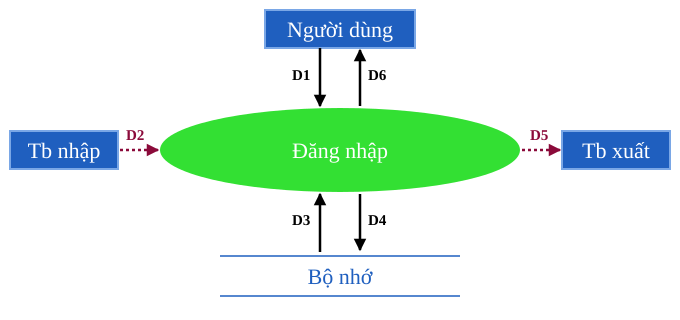

**2) Mô tả các luồng dữ liệu:**

- **D1:** Tên đăng nhập (mã số sinh viên hoặc mã cán bộ), Mật khẩu.
- **D2:** *Không có*
- **D3:** Tài khoản (Tên đăng nhập, Mật khẩu đã băm, Vai trò, Phải đổi mật khẩu) (`user_account`). Số lần đăng
  nhập sai gần đây của tài khoản và địa chỉ IP (Redis).
- **D4:** Session mới, hết hạn tuyệt đối sau 8 giờ (Redis). Thời điểm đăng nhập cuối. Nếu đăng nhập sai: số lần sai
  tăng thêm 1.
- **D5:** *Không có*
- **D6:** Kết quả đăng nhập (Họ tên, Vai trò, Phải đổi mật khẩu hay không), hoặc thông báo sai thông tin.

**3) Thuật toán:**

- **B1:** Nhận **D1** từ người dùng
- **B2:** Kết nối cơ sở dữ liệu
- **B3:** Đọc **D3** từ bộ nhớ phụ
- **B4:** Kiểm tra Số lần đăng nhập sai (D3) đã vượt giới hạn tần suất hay chưa (NFR-05)? Nếu đã vượt đến **B8**
- **B5:** Kiểm tra Tên đăng nhập (D1) có thuộc danh sách tài khoản (D3) hay không, rồi kiểm tra Mật khẩu (D1) sau
  khi băm argon2id có khớp Mật khẩu đã băm (D3) hay không? Nếu một trong hai không thoả thì lưu số lần sai tăng
  thêm 1 và đến **B8**
- **B6:** Lưu **D4** xuống bộ nhớ phụ
- **B7:** Nếu Phải đổi mật khẩu (D3) thì chỉ cho vào màn hình Đổi mật khẩu (mục 2, QĐ01.6)
- **B8:** Xuất **D6** cho người dùng
- **B9:** Đóng kết nối cơ sở dữ liệu
- **B10:** Kết thúc

> **Ghi chú:** B5 gộp hai lỗi "không có tài khoản" và "sai mật khẩu" thành một thông báo, để không lộ tên đăng
> nhập nào tồn tại (QĐ01.3). Không có trạng thái khoá tài khoản: tài khoản sinh viên mất đi cùng hồ sơ (mục 11),
> tài khoản nhân viên là dữ liệu nền.

---

### 2. Lập sơ đồ luồng dữ liệu cho yêu cầu Đổi mật khẩu

Người dùng: mọi vai trò. Yêu cầu: YC01. Qui định: QĐ01.7–QĐ01.9, NFR-08.

**1) Sơ đồ:**

**2) Mô tả các luồng dữ liệu:**

- **D1:** Mật khẩu hiện tại, Mật khẩu mới, Nhập lại mật khẩu mới.
- **D2:** *Không có*
- **D3:** Mật khẩu đã băm hiện tại của tài khoản (`user_account`).
- **D4:** Mật khẩu mới đã băm argon2id. Phải đổi mật khẩu = sai.
- **D5:** *Không có*
- **D6:** *Không có*

**3) Thuật toán:**

- **B1:** Nhận **D1** từ người dùng
- **B2:** Kết nối cơ sở dữ liệu
- **B3:** Đọc **D3** từ bộ nhớ phụ
- **B4:** Kiểm tra Mật khẩu hiện tại (D1) sau khi băm có khớp Mật khẩu đã băm (D3) hay không? Nếu không đến **B8**
- **B5:** Kiểm tra Mật khẩu mới (D1) = Nhập lại mật khẩu mới (D1) hay không? Nếu không đến **B8**
- **B6:** Kiểm tra Mật khẩu mới (D1) ≠ Mật khẩu hiện tại (D1) hay không? Nếu không đến **B8**
- **B7:** Lưu **D4** xuống bộ nhớ phụ
- **B8:** Đóng kết nối cơ sở dữ liệu
- **B9:** Kết thúc

---

## Phần II. Sinh viên

### 3. Lập sơ đồ luồng dữ liệu cho yêu cầu Tra cứu lớp học phần mở

Người dùng: Sinh viên. Yêu cầu: YC02. Qui định: QĐ02.1–QĐ02.3, QĐ4, DT-08, DT-09.

**1) Sơ đồ:**

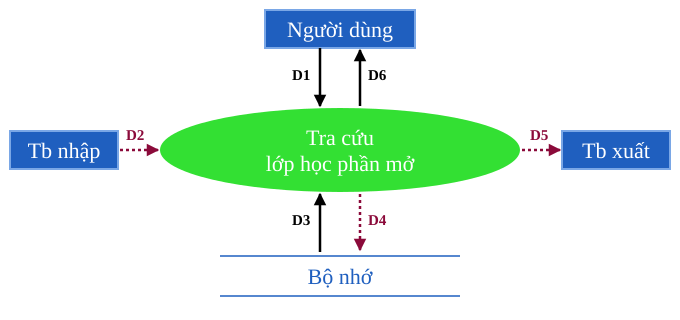

**2) Mô tả các luồng dữ liệu:**

- **D1:** Học kỳ, Điều kiện lọc (Mã hoặc tên môn học, Thứ, Loại môn, Khoá dành cho), Chỉ hiện lớp cùng hệ (mặc định
  có).
- **D2:** *Không có*
- **D3:** Danh sách học kỳ (`term`). Hệ đào tạo của sinh viên (`student`). Danh sách lớp học phần của các môn mở
  trong Học kỳ (D1): Mã lớp, Môn học, Loại môn, Số tín chỉ của môn mở, Hệ đào tạo, Giảng viên, Lịch học (Thứ,
  Tiết, Phòng, Ngày bắt đầu, Ngày kết thúc, Nhịp), Khoá dành cho, Ngôn ngữ, Ghi chú, Sĩ số tối đa, Số đã đăng ký,
  các nhóm thực hành con và Hình thức thực hành (`offered_course`, `course_section`, `meeting`).
- **D4:** *Không có*
- **D5:** *Không có*
- **D6:** Danh sách lớp thoả Điều kiện lọc (D1), mỗi lớp kèm Số chỗ còn.

**3) Thuật toán:**

- **B1:** Nhận **D1** từ người dùng
- **B2:** Kết nối cơ sở dữ liệu
- **B3:** Đọc **D3** từ bộ nhớ phụ
- **B4:** Kiểm tra Học kỳ (D1) có thuộc danh sách học kỳ (D3) hay không? Nếu không đến **B9**
- **B5:** Nếu Chỉ hiện lớp cùng hệ (D1) thì bỏ các lớp có Hệ đào tạo khác hệ của sinh viên (D3)
- **B6:** Lọc danh sách lớp (D3) theo Điều kiện lọc (D1)
- **B7:** Với mỗi lớp, tính Số chỗ còn = Sĩ số tối đa − Số đã đăng ký
- **B8:** Xuất **D6** cho người dùng
- **B9:** Đóng kết nối cơ sở dữ liệu
- **B10:** Kết thúc

> **Ghi chú:** Danh sách lớp và số chỗ còn được cache tối đa 3 giây, và trang đăng ký tự làm mới mỗi 5 giây
> (QĐ02.3). Số chỗ còn ở D6 có thể đã cũ. Bước giành chỗ ở mục 4 mới là kiểm tra cuối cùng. Khoá dành cho chỉ để
> lọc và tham khảo, không chặn đăng ký (QĐ03.3).

---

### 4. Lập sơ đồ luồng dữ liệu cho yêu cầu Đăng ký lớp học phần

Người dùng: Sinh viên. Yêu cầu: YC03. Biểu mẫu: BM5. Qui định: QĐ5, DK-01–DK-12, DK-16, DK-18, DK-19, HP-03,
HP-04, HP-06, ADR-0005.

**1) Sơ đồ:**

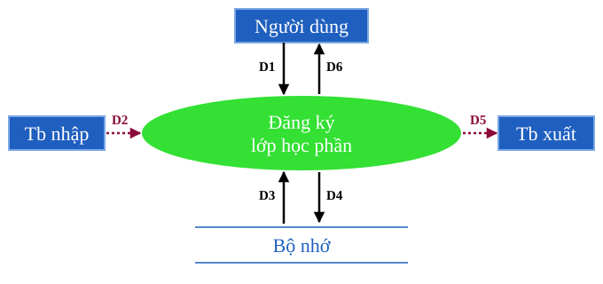

**2) Mô tả các luồng dữ liệu:**

- **D1:** Danh sách lớp trong lượt đăng ký (mỗi lớp là một lớp lý thuyết hoặc một nhóm thực hành), Khoá chống lặp.
- **D2:** *Không có*
- **D3:**
  - Kết quả đã lưu của Khoá chống lặp (Redis).
  - Học kỳ đang mở đăng ký: Loại (chính hoặc hè), Giai đoạn, Tín chỉ tối đa. Khung giờ đăng ký của khoá sinh viên
    (`term`, `registration_slot`).
  - Hồ sơ sinh viên: Khoá, Hệ đào tạo, đối tượng ưu tiên có độ ưu tiên cao nhất và Tỉ lệ giảm của đối tượng đó
    (`student`, `priority_group`).
  - Phiếu đăng ký của sinh viên trong học kỳ và các dòng còn hiệu lực: Lớp, Môn học, Số tín chỉ, Lịch học
    (`registration_form`, `enrollment`).
  - Môn của lớp: Loại môn, Môn LT đi kèm, Nhóm tương đương, Số tín chỉ của môn mở trong học kỳ (`course`,
    `offered_course`).
  - Lớp: Hệ đào tạo, Lịch học, Sĩ số tối đa, Số đã đăng ký, Lớp lý thuyết cha (`course_section`, `meeting`).
  - Điều kiện tiên quyết của môn. Các lần học trước của sinh viên và điểm học phần, tính cả môn tương đương (dữ liệu
    nền).
  - Bảng phí của (Khoá, Hệ đào tạo): Đơn giá tín chỉ LT, TH (`fee_schedule`).
- **D4:**
  - Phiếu đăng ký, nếu sinh viên chưa có phiếu trong học kỳ.
  - Với mỗi lớp đạt: dòng đăng ký mới gồm Lớp, Môn, Hình thức học, Có điều kiện, Số tín chỉ, Đơn giá, Phụ thu.
  - Số đã đăng ký của mỗi lớp đạt tăng thêm 1.
  - Nếu Phụ thu > 0: dòng sổ cái ghi nợ Phụ thu và dòng sổ cái Giảm trừ (`ledger_entry`).
  - Kết quả của Khoá chống lặp, giữ 24 giờ.
- **D5:** *Không có* (in phiếu ở mục 6)
- **D6:** Kết quả theo từng lớp trong lượt: đạt, hoặc lỗi đầu tiên gặp phải theo thứ tự kiểm tra của DK-10. Phiếu
  đăng ký sau khi cập nhật.

**3) Thuật toán:**

Ở các bước B7 → B16, "lớp không đạt" nghĩa là: ghi lỗi của lớp đó vào D6, huỷ transaction và quay lại **B5**.

- **B1:** Nhận **D1** từ người dùng
- **B2:** Kết nối cơ sở dữ liệu
- **B3:** Đọc Kết quả đã lưu của Khoá chống lặp (D3). Nếu đã có thì lấy kết quả đó làm D6 và đến **B18**
- **B4:** Sắp xếp danh sách lớp (D1) theo thứ tự trong lượt, nhưng đưa lớp lý thuyết lên trước nhóm thực hành con
  của nó (DK-18)
- **B5:** Lấy lớp kế tiếp trong danh sách. Nếu đã hết đến **B17**
- **B6:** Mở transaction, khoá phiếu đăng ký của sinh viên trong học kỳ để tuần tự hoá các thao tác của cùng một
  sinh viên (tạo phiếu nếu chưa có). Đọc các phần còn lại của **D3** từ bộ nhớ phụ
- **B7:** Kiểm tra thời gian đăng ký (DK-02): Giai đoạn (D3) là Đăng ký hoặc Điều chỉnh, và nếu đang ở giai đoạn
  Đăng ký thì thời điểm hiện tại nằm trong khung giờ của khoá sinh viên. Nếu không thoả thì lớp không đạt
- **B8:** Kiểm tra Môn của lớp có mở trong học kỳ (D3) hay không (DK-03)? Nếu không thì lớp không đạt
- **B9:** Kiểm tra Hệ đào tạo của lớp (D3) có bằng Hệ đào tạo của sinh viên (D3) hay không (DK-19)? Nếu không thì
  lớp không đạt
- **B10:** Kiểm tra phiếu (D3) đã có dòng còn hiệu lực của cùng môn hoặc môn tương đương hay chưa (DK-04)? Nếu có
  thì lớp không đạt
- **B11:** Nếu lớp là nhóm thực hành (DK-11, DK-12): Lớp lý thuyết cha phải có dòng còn hiệu lực trong phiếu (D3),
  kể cả dòng vừa đạt ở lượt này. Ngoại lệ học lại tách: sinh viên đã Đạt môn LT đi kèm thì chọn được nhóm con của
  bất kỳ lớp lý thuyết nào. Nếu không thoả thì lớp không đạt
- **B12:** Kiểm tra tiên quyết (DK-05). Với mỗi điều kiện của môn (D3), tính cả môn tương đương:
  - môn Tiên quyết phải có kết quả hiện hành Đạt;
  - môn Học trước phải có lần học đã có điểm.

  Nếu chưa thoả nhưng sinh viên có lần học môn điều kiện chưa có điểm thì đánh dấu dòng đăng ký Có điều kiện.
  Ngược lại thì lớp không đạt
- **B13:** Kiểm tra trùng lịch (DK-07): lịch của lớp có trùng lớp nào còn hiệu lực trong phiếu (D3) hay không? Hai
  buổi trùng khi cùng thứ, khoảng tiết giao nhau và có ít nhất một ngày học chung, tính từ ngày bắt đầu, ngày kết
  thúc và nhịp. Lớp không có buổi học, gồm nhóm thực hành HT2, không bao giờ trùng. Nếu trùng thì lớp không đạt
- **B14:** Kiểm tra tín chỉ (DK-08): tổng tín chỉ các dòng còn hiệu lực (D3) + Số tín chỉ của môn mở (D3) ≤ Tín
  chỉ tối đa (D3) hay không? Nếu không thì lớp không đạt
- **B15:** Suy ra Hình thức học (DK-16): kết quả hiện hành Không đạt → Học lại; đã từng Đạt → Cải thiện; còn lại →
  Lần đầu. Tính Phụ thu (HP-03):
  - Học kỳ chính: dòng Học lại hoặc Cải thiện có Phụ thu = Số tín chỉ × Đơn giá theo loại môn. Dòng Lần đầu có
    Phụ thu = 0.
  - Học kỳ hè: mọi dòng đều có phụ thu.
  - Giảm trừ = làm tròn xuống tới đồng (Phụ thu × Tỉ lệ giảm / 100) (HP-06).
- **B16:** Giành chỗ (DK-09): tăng Số đã đăng ký của lớp khi Số đã đăng ký < Sĩ số tối đa. Nếu lớp đã hết chỗ thì
  lớp không đạt. Ngược lại lưu các phần của **D4** cho lớp này xuống bộ nhớ phụ, kết thúc transaction, ghi lớp đạt
  vào D6 và quay lại **B5**
- **B17:** Lưu Kết quả của Khoá chống lặp (D4)
- **B18:** Xuất **D6** cho người dùng
- **B19:** Đóng kết nối cơ sở dữ liệu
- **B20:** Kết thúc

> **Ghi chú:** Thứ tự B7 → B16 là thứ tự bắt buộc của DK-10 (DK-02 → DK-03 → DK-19 → DK-04 → DK-11 → DK-05 →
> DK-07 → DK-08 → DK-09), nên lỗi của mỗi lớp luôn là lỗi đầu tiên gặp phải. Mỗi lớp được xét trong một
> transaction riêng, nên lớp này không đạt không làm lớp khác bị từ chối (DK-18, ADR-0005). B16 là một câu
> `UPDATE … WHERE enrolled_count < capacity` nguyên tử, làm cuối để giữ khoá hàng "lớp" trong thời gian ngắn
> nhất. Lớp lý thuyết không đạt thì nhóm thực hành con trong cùng lượt cũng không đạt ở B11. Dòng Có điều kiện được
> xét lại hằng ngày ở mục 27.

---

### 5. Lập sơ đồ luồng dữ liệu cho yêu cầu Huỷ lớp học phần

Người dùng: Sinh viên. Yêu cầu: YC04. Qui định: DK-02, DK-11, DK-13, DK-14, HP-05, ADR-0005.

**1) Sơ đồ:**

**2) Mô tả các luồng dữ liệu:**

- **D1:** Dòng đăng ký cần huỷ, Khoá chống lặp.
- **D2:** *Không có*
- **D3:**
  - Kết quả đã lưu của Khoá chống lặp.
  - Học kỳ (Giai đoạn), khung giờ của khoá sinh viên.
  - Dòng đăng ký: Phiếu, Trạng thái, Lớp, dòng đi kèm trong phiếu (dòng nhóm thực hành con nếu là lớp lý thuyết,
    dòng lớp lý thuyết cha nếu là nhóm thực hành), các dòng sổ cái Phụ thu và Giảm trừ của các dòng đó
    (`enrollment`, `ledger_entry`).
- **D4:**
  - Dòng đăng ký và dòng đi kèm chuyển sang Đã huỷ, kèm Thời điểm huỷ.
  - Số đã đăng ký của các lớp tương ứng giảm 1.
  - Dòng sổ cái đảo Phụ thu và đảo Giảm trừ.
  - Kết quả của Khoá chống lặp.
- **D5:** *Không có*
- **D6:** Phiếu đăng ký sau khi cập nhật, hoặc lỗi.

**3) Thuật toán:**

- **B1:** Nhận **D1** từ người dùng
- **B2:** Kết nối cơ sở dữ liệu
- **B3:** Đọc Kết quả đã lưu của Khoá chống lặp (D3). Nếu đã có thì lấy kết quả đó làm D6 và đến **B10**
- **B4:** Mở transaction, khoá phiếu đăng ký. Đọc các phần còn lại của **D3** từ bộ nhớ phụ
- **B5:** Kiểm tra Dòng đăng ký (D1) có thuộc phiếu của chính sinh viên và đang ở trạng thái Đã đăng ký hay không?
  Dòng đã chốt hoặc đã huỷ thì không huỷ được (DK-14, DK-15). Nếu không thoả đến **B10**
- **B6:** Kiểm tra thời gian thao tác (DK-02) như B7 của mục 4. Nếu không thoả đến **B10**
- **B7:** Huỷ hai chiều (DK-11): nếu dòng (D1) là lớp lý thuyết thì đưa luôn dòng nhóm thực hành con còn hiệu lực
  vào danh sách huỷ; nếu là nhóm thực hành thì đưa luôn dòng lớp lý thuyết cha còn hiệu lực vào danh sách huỷ. Khoá
  các lớp trong danh sách theo id tăng dần (ADR-0005) rồi giảm Số đã đăng ký của từng lớp
- **B8:** Với mỗi dòng cần huỷ có Phụ thu > 0, lập dòng sổ cái đảo Phụ thu và đảo Giảm trừ đúng bằng số tiền đã ghi
  (HP-05)
- **B9:** Lưu **D4** xuống bộ nhớ phụ, kết thúc transaction
- **B10:** Xuất **D6** cho người dùng
- **B11:** Đóng kết nối cơ sở dữ liệu
- **B12:** Kết thúc

> **Ghi chú:** Không có thao tác đổi lớp (DK-13). Muốn sang lớp khác, sinh viên huỷ ở mục này rồi đăng ký lại ở
> mục 4. Chỗ cũ được trả ngay ở B7, không được giữ. Mục 27 dùng lại B7–B8 khi tự huỷ dòng có điều kiện.

---

### 6. Lập sơ đồ luồng dữ liệu cho yêu cầu Xem và in phiếu đăng ký, thời khoá biểu

Người dùng: Sinh viên. Yêu cầu: YC05. Biểu mẫu: BM5, BB02. Qui định: QĐ05.1–QĐ05.3, NFR-12.

**1) Sơ đồ:**

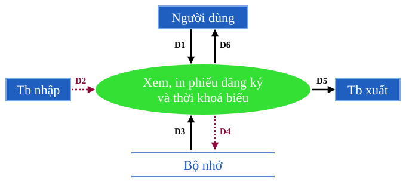

**2) Mô tả các luồng dữ liệu:**

- **D1:** Học kỳ, Yêu cầu in (có hoặc không).
- **D2:** *Không có*
- **D3:** Phiếu đăng ký của sinh viên trong Học kỳ (D1): Số phiếu, Mã số sinh viên, Ngày lập, Học kỳ, Năm học. Các
  dòng còn hiệu lực: Môn học, Số tín chỉ, Lớp, Hình thức học, Lịch học (Thứ, Tiết, Phòng, Ngày bắt đầu, Ngày kết
  thúc, Nhịp).
- **D4:** *Không có*
- **D5:** Phiếu đăng ký học phần (BM5): Số phiếu, Ngày lập, Mã số sinh viên, Học kỳ, Năm học, và bảng (Stt, Môn
  học, Số tín chỉ, Lớp học phần, Hình thức học).
- **D6:** Phiếu đăng ký và thời khoá biểu dạng lưới tuần (BB02).

**3) Thuật toán:**

- **B1:** Nhận **D1** từ người dùng
- **B2:** Kết nối cơ sở dữ liệu
- **B3:** Đọc **D3** từ bộ nhớ phụ
- **B4:** Kiểm tra sinh viên có phiếu đăng ký trong Học kỳ (D1) hay không? Nếu không đến **B8**
- **B5:** Xếp các buổi học của các dòng (D3) vào lưới tuần theo Thứ và Tiết. Lớp không có buổi học được liệt kê
  dưới lưới
- **B6:** Xuất **D6** cho người dùng
- **B7:** Nếu có Yêu cầu in (D1) thì xuất **D5** ra máy in
- **B8:** Đóng kết nối cơ sở dữ liệu
- **B9:** Kết thúc

---

### 7. Lập sơ đồ luồng dữ liệu cho yêu cầu Xem công nợ và mã QR học phí

Người dùng: Sinh viên. Yêu cầu: YC06. Qui định: QĐ6, QĐ7, HP-09, TT-02, TT-03, ADR-0011.

**1) Sơ đồ:**

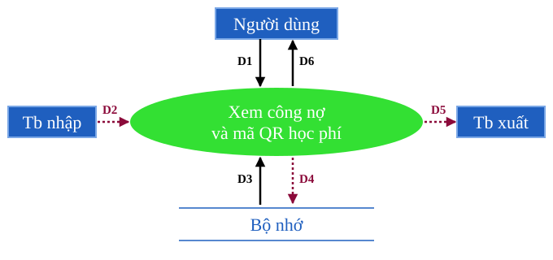

**2) Mô tả các luồng dữ liệu:**

- **D1:** Học kỳ.
- **D2:** *Không có*
- **D3:**
  - Các dòng sổ cái của sinh viên trong Học kỳ (D1): Loại, Ghi nợ hoặc Ghi có, Số tiền, Mô tả (`ledger_entry`).
  - Mã số sinh viên, Mã học kỳ, Hạn đóng học phí.
  - Tài khoản nhận học phí (`system_parameter`).
- **D4:** *Không có*
- **D5:** *Không có*
- **D6:**
  - Số tiền đăng ký, Số tiền phải đóng, Đã thanh toán, Số tiền còn lại, Hạn đóng học phí, chi tiết từng dòng sổ
    cái (gồm các dòng đảo khi huỷ lớp hoặc tính lại học phí).
  - Nếu Số tiền còn lại > 0: mã QR VietQR kèm Số tài khoản, Số tiền và Nội dung chuyển khoản để sao chép.

**3) Thuật toán:**

- **B1:** Nhận **D1** từ người dùng
- **B2:** Kết nối cơ sở dữ liệu
- **B3:** Đọc **D3** từ bộ nhớ phụ
- **B4:** Tính theo HP-09:
  - Số tiền đăng ký = tổng các khoản ghi nợ trước giảm.
  - Số tiền phải đóng = Số tiền đăng ký − Giảm trừ.
  - Số tiền còn lại = Số tiền phải đóng − Đã thanh toán.
- **B5:** Kiểm tra Số tiền còn lại > 0 hay không? Nếu không đến **B7**
- **B6:** Lập Mã thanh toán = `HP` + Mã số sinh viên + Mã học kỳ (TT-02). Sinh mã QR VietQR với Tài khoản nhận
  (D3), Số tiền = Số tiền còn lại, Nội dung = Mã thanh toán (TT-03)
- **B7:** Xuất **D6** cho người dùng
- **B8:** Đóng kết nối cơ sở dữ liệu
- **B9:** Kết thúc

> **Ghi chú:** Không lưu "yêu cầu thanh toán" nào (ADR-0011). Mã QR sinh lại mỗi lần xem, nên số tiền luôn bằng
> số còn lại tại lúc xem, và sinh viên không sửa được số tiền.

---

### 8. Lập sơ đồ luồng dữ liệu cho yêu cầu Xem và in phiếu thu

Người dùng: Sinh viên. Yêu cầu: YC07. Biểu mẫu: BM6. Qui định: QĐ6, TT-01, QV-02.

**1) Sơ đồ:**

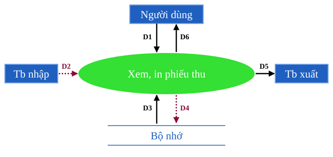

**2) Mô tả các luồng dữ liệu:**

- **D1:** Phiếu thu cần xem, Yêu cầu in (có hoặc không).
- **D2:** *Không có*
- **D3:** Phiếu thu: Số phiếu, Ngày lập, Mã số sinh viên, Học kỳ, Số tiền thu, Kênh thanh toán, Thời điểm đóng,
  Người thu (`receipt`).
- **D4:** *Không có*
- **D5:** Phiếu thu học phí (BM6): Số phiếu, Ngày lập, Mã số sinh viên, Số tiền thu, Học kỳ, Kênh thanh toán, Thời
  điểm đóng, Người thu.
- **D6:** Thông tin phiếu thu.

**3) Thuật toán:**

- **B1:** Nhận **D1** từ người dùng
- **B2:** Kết nối cơ sở dữ liệu
- **B3:** Đọc **D3** từ bộ nhớ phụ
- **B4:** Kiểm tra Phiếu thu (D1) có thuộc chính sinh viên hay không (QV-02)? Nếu không đến **B7**
- **B5:** Xuất **D6** cho người dùng
- **B6:** Nếu có Yêu cầu in (D1) thì xuất **D5** ra máy in
- **B7:** Đóng kết nối cơ sở dữ liệu
- **B8:** Kết thúc

---

## Phần III. Phòng Đào tạo

### 9. Lập sơ đồ luồng dữ liệu cho yêu cầu Lập hồ sơ sinh viên

Người dùng: Phòng Đào tạo. Yêu cầu: YC08. Biểu mẫu: BM1. Qui định: QĐ1, QĐ08.1–QĐ08.5, HS-02, HS-11, HS-13.

**1) Sơ đồ:**

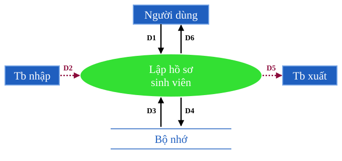

**2) Mô tả các luồng dữ liệu:**

- **D1:** Mã số sinh viên, Họ tên, Email, Khoá tuyển sinh, Hệ đào tạo, Danh sách đối tượng ưu tiên (có thể rỗng).
- **D2:** *Không có*
- **D3:** Danh sách mã số sinh viên và tên đăng nhập đã có (`student`, `user_account`). Danh sách khoá tuyển sinh
  (`cohort`). Danh sách hệ đào tạo (dữ liệu nền). Danh sách đối tượng ưu tiên (`priority_group`).
- **D4:**
  - Hồ sơ sinh viên mới (`student`) và các đối tượng ưu tiên của sinh viên (`student_priority_group`).
  - Tài khoản Sinh viên (`user_account`): Tên đăng nhập = Mã số sinh viên, Mật khẩu ngẫu nhiên đã băm argon2id,
    Vai trò Sinh viên, Phải đổi mật khẩu = đúng.
- **D5:** *Không có*
- **D6:** Mật khẩu ban đầu dạng rõ, hiện một lần duy nhất.

**3) Thuật toán:**

- **B1:** Nhận **D1** từ người dùng
- **B2:** Kết nối cơ sở dữ liệu
- **B3:** Đọc **D3** từ bộ nhớ phụ
- **B4:** Kiểm tra Mã số sinh viên (D1) chưa có trong danh sách mã số sinh viên và tên đăng nhập (D3)? Nếu đã có đến
  **B11**
- **B5:** Kiểm tra Khoá tuyển sinh (D1) có thuộc danh sách khoá (D3) hay không? Nếu không đến **B11**
- **B6:** Kiểm tra Hệ đào tạo (D1) có thuộc danh sách hệ đào tạo (D3) hay không? Nếu không đến **B11**
- **B7:** Kiểm tra mọi đối tượng trong Danh sách đối tượng ưu tiên (D1) có thuộc danh sách đối tượng (D3) hay không?
  Nếu không đến **B11**
- **B8:** Sinh Mật khẩu ngẫu nhiên, băm bằng argon2id
- **B9:** Lưu **D4** xuống bộ nhớ phụ trong cùng một transaction
- **B10:** Xuất **D6** cho người dùng
- **B11:** Đóng kết nối cơ sở dữ liệu
- **B12:** Kết thúc

> **Ghi chú:** Mật khẩu dạng rõ không lưu ở đâu, kể cả nhật ký kiểm toán. Đóng màn hình là mất; muốn có lại thì đặt
> lại mật khẩu ở mục 12. Sinh viên lập hồ sơ giữa đợt đăng ký không được ghi nợ học phí cố định của học kỳ đang mở,
> vì việc ghi nợ chỉ chạy lúc học kỳ vào giai đoạn Đăng ký (mục 22).

---

### 10. Lập sơ đồ luồng dữ liệu cho yêu cầu Cập nhật hồ sơ sinh viên và tính lại học phí

Người dùng: Phòng Đào tạo. Yêu cầu: YC08. Biểu mẫu: BM1. Qui định: QĐ08.6–QĐ08.8, HS-12, HS-14, HP-06, HP-12.

**1) Sơ đồ:**

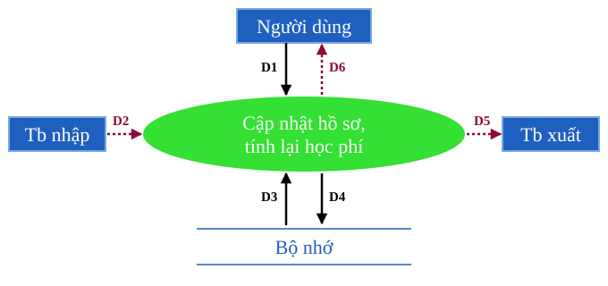

**2) Mô tả các luồng dữ liệu:**

- **D1:** Sinh viên cần sửa, Họ tên, Email, Khoá tuyển sinh, Hệ đào tạo, Danh sách đối tượng ưu tiên.
- **D2:** *Không có*
- **D3:**
  - Hồ sơ hiện tại của sinh viên: Khoá, Hệ đào tạo, các đối tượng ưu tiên (`student`, `student_priority_group`).
  - Danh sách khoá, hệ đào tạo, đối tượng ưu tiên kèm Tỉ lệ giảm và Độ ưu tiên.
  - Học kỳ đang ở giai đoạn Đăng ký hoặc Điều chỉnh, nếu có, kèm Loại học kỳ (`term`).
  - Nếu có học kỳ đó: các dòng sổ cái ghi nợ và giảm trừ còn hiệu lực của sinh viên trong học kỳ
    (`ledger_entry`), các dòng đăng ký còn hiệu lực kèm Số tín chỉ và Loại môn (`enrollment`), bảng phí của (Khoá,
    Hệ đào tạo) mới (`fee_schedule`).
- **D4:**
  - Hồ sơ sau khi sửa và danh sách đối tượng ưu tiên mới.
  - Nếu phải tính lại học phí: dòng đảo cho mọi khoản ghi nợ và giảm trừ cũ của học kỳ; các dòng ghi nợ học phí cố
    định, phụ thu và giảm trừ mới; Đơn giá mới của từng dòng đăng ký.
- **D5:** *Không có*
- **D6:** *Không có*

**3) Thuật toán:**

- **B1:** Nhận **D1** từ người dùng
- **B2:** Kết nối cơ sở dữ liệu
- **B3:** Đọc **D3** từ bộ nhớ phụ
- **B4:** Kiểm tra Khoá, Hệ đào tạo và các đối tượng ưu tiên (D1) đều có trong danh mục (D3)? Nếu không đến **B11**
- **B5:** Mở transaction, lưu hồ sơ và danh sách đối tượng ưu tiên mới
- **B6:** Kiểm tra Khoá, Hệ đào tạo hoặc đối tượng ưu tiên có khác hồ sơ hiện tại (D3) hay không, và có học kỳ đang
  ở giai đoạn Đăng ký hoặc Điều chỉnh (D3) hay không? Nếu một trong hai không thoả đến **B10**
- **B7:** Với mỗi dòng ghi nợ và giảm trừ còn hiệu lực của sinh viên trong học kỳ (D3), ghi một dòng đảo đúng bằng
  số tiền đã ghi (HP-12)
- **B8:** Ghi lại theo hồ sơ mới:
  - Học kỳ chính: ghi nợ học phí cố định theo bảng phí của (Khoá, Hệ đào tạo) mới.
  - Với mỗi dòng đăng ký còn hiệu lực: chép Đơn giá mới vào dòng, rồi ghi nợ Phụ thu như B15 mục 4.
  - Mỗi khoản ghi nợ vừa ghi kèm một dòng Giảm trừ theo Tỉ lệ giảm của đối tượng có Độ ưu tiên cao nhất mới.
- **B9:** Lưu các dòng sổ cái của B7–B8 xuống bộ nhớ phụ
- **B10:** Kết thúc transaction
- **B11:** Đóng kết nối cơ sở dữ liệu
- **B12:** Kết thúc

> **Ghi chú:**
>
> - Mã số sinh viên không có ở D1: không sửa được (HS-12).
> - Dòng thanh toán không bị đảo. Nếu sau khi tính lại, số tiền phải đóng nhỏ hơn số đã đóng thì phần dư thành số
>   dư có, chuyển sang học kỳ sau (HP-11).
> - Dòng đăng ký giữ nguyên, kể cả khi lớp khác hệ đào tạo mới (DK-19 chỉ xét lúc đăng ký). Số tín chỉ và Hình
>   thức học không đổi.
> - Ngoài đợt đăng ký thì chỉ lưu hồ sơ (B5). Học kỳ sau dùng hồ sơ mới khi ghi nợ ở mục 22.

---

### 11. Lập sơ đồ luồng dữ liệu cho yêu cầu Xoá hồ sơ sinh viên

Người dùng: Phòng Đào tạo. Yêu cầu: YC08. Qui định: QĐ08.9, HS-12, HS-13.

**1) Sơ đồ:**

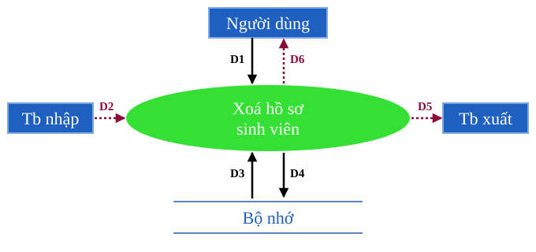

**2) Mô tả các luồng dữ liệu:**

- **D1:** Sinh viên cần xoá.
- **D2:** *Không có*
- **D3:** Số phiếu đăng ký của sinh viên (`registration_form`). Số dòng sổ cái của sinh viên (`ledger_entry`).
- **D4:** Xoá hồ sơ (`student`), các đối tượng ưu tiên của sinh viên (`student_priority_group`), tài khoản
  (`user_account`) và mọi session của tài khoản (Redis).
- **D5:** *Không có*
- **D6:** *Không có*

**3) Thuật toán:**

- **B1:** Nhận **D1** từ người dùng
- **B2:** Kết nối cơ sở dữ liệu
- **B3:** Đọc **D3** từ bộ nhớ phụ
- **B4:** Kiểm tra Số phiếu đăng ký (D3) = 0 hay không? Nếu không đến **B7**
- **B5:** Kiểm tra Số dòng sổ cái (D3) = 0 hay không? Nếu không đến **B7**
- **B6:** Lưu **D4** xuống bộ nhớ phụ trong cùng một transaction
- **B7:** Đóng kết nối cơ sở dữ liệu
- **B8:** Kết thúc

> **Ghi chú:** Sinh viên đã có dữ liệu nghiệp vụ thì không xoá được, để sổ cái và nhật ký luôn trỏ tới một hồ sơ có
> thật. Học kỳ chính đã vào giai đoạn Đăng ký thì mọi sinh viên đều đã có dòng ghi nợ học phí cố định, nên chỉ hồ
> sơ vừa lập sau mốc đó mới xoá được.

---

### 12. Lập sơ đồ luồng dữ liệu cho yêu cầu Đặt lại mật khẩu sinh viên

Người dùng: Phòng Đào tạo. Yêu cầu: YC08. Qui định: QĐ08.10, HS-13, NFR-08, ADR-0013.

**1) Sơ đồ:**

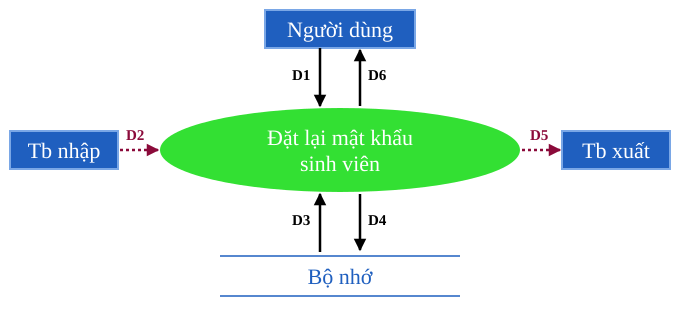

**2) Mô tả các luồng dữ liệu:**

- **D1:** Sinh viên cần đặt lại mật khẩu.
- **D2:** *Không có*
- **D3:** Tài khoản của sinh viên (`user_account`). Danh sách session của tài khoản (Redis).
- **D4:** Mật khẩu ngẫu nhiên mới đã băm argon2id. Phải đổi mật khẩu = đúng. Xoá mọi session của tài khoản.
- **D5:** *Không có*
- **D6:** Mật khẩu mới dạng rõ, hiện một lần duy nhất.

**3) Thuật toán:**

- **B1:** Nhận **D1** từ người dùng
- **B2:** Kết nối cơ sở dữ liệu
- **B3:** Đọc **D3** từ bộ nhớ phụ
- **B4:** Kiểm tra sinh viên (D1) có tài khoản (D3) hay không? Nếu không đến **B8**
- **B5:** Sinh Mật khẩu ngẫu nhiên, băm bằng argon2id
- **B6:** Lưu **D4** xuống bộ nhớ phụ
- **B7:** Xuất **D6** cho người dùng
- **B8:** Đóng kết nối cơ sở dữ liệu
- **B9:** Kết thúc

> **Ghi chú:** Xoá session ở B6 đẩy sinh viên ra khỏi mọi thiết bị ngay. Lần đăng nhập kế tiếp, mục 1 chuyển sinh
> viên tới màn hình Đổi mật khẩu.

---

### 13. Lập sơ đồ luồng dữ liệu cho yêu cầu Quản lý khoá tuyển sinh

Người dùng: Phòng Đào tạo. Yêu cầu: YC09. Qui định: QĐ09.1, QĐ09.2, HS-15.

**1) Sơ đồ:**

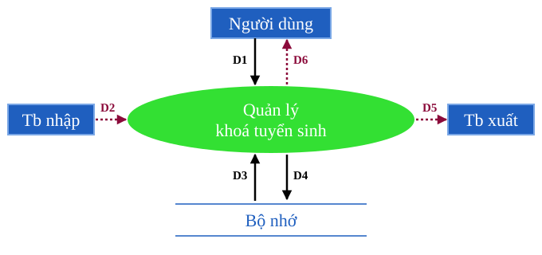

**2) Mô tả các luồng dữ liệu:**

- **D1:** Thao tác (Thêm, Sửa, Xoá), Năm nhập học, Tên khoá.
- **D2:** *Không có*
- **D3:** Danh sách khoá tuyển sinh (`cohort`). Với thao tác Xoá: số sinh viên (`student`), số bảng phí
  (`fee_schedule`) và số khung giờ đăng ký (`registration_slot_cohort`) đang tham chiếu khoá.
- **D4:** Khoá tuyển sinh mới, khoá sau khi sửa, hoặc xoá khoá.
- **D5:** *Không có*
- **D6:** *Không có*

**3) Thuật toán:**

- **B1:** Nhận **D1** từ người dùng
- **B2:** Kết nối cơ sở dữ liệu
- **B3:** Đọc **D3** từ bộ nhớ phụ
- **B4:** Nếu Thao tác là Thêm hoặc Sửa: kiểm tra Năm nhập học (D1) chưa trùng khoá khác trong danh sách (D3)? Nếu
  trùng đến **B7**
- **B5:** Nếu Thao tác là Xoá: kiểm tra số sinh viên, số bảng phí và số khung giờ tham chiếu khoá (D3) đều = 0? Nếu
  không đến **B7**
- **B6:** Lưu **D4** xuống bộ nhớ phụ
- **B7:** Đóng kết nối cơ sở dữ liệu
- **B8:** Kết thúc

> **Ghi chú:** Thêm khoá mới không tự tạo bảng phí. Phòng Tài vụ phải lập bảng phí cho các cặp (khoá, hệ) của khoá
> mới (qui định 4, [thay đổi qui định](./thay-doi-qui-dinh.md)) trước khi học kỳ kế tiếp vào giai đoạn Đăng ký.

---

### 14. Lập sơ đồ luồng dữ liệu cho yêu cầu Cập nhật mốc thời gian học kỳ

Người dùng: Phòng Đào tạo. Yêu cầu: YC10. Qui định: QĐ10.1–QĐ10.5, HK-02, HK-04, HK-06.

**1) Sơ đồ:**

**2) Mô tả các luồng dữ liệu:**

- **D1:** Học kỳ, 5 mốc mới: Bắt đầu đăng ký, Kết thúc đăng ký, Bắt đầu điều chỉnh, Kết thúc điều chỉnh, Hạn đóng
  học phí.
- **D2:** *Không có*
- **D3:** 5 mốc hiện tại của Học kỳ (`term`). 5 mốc của các học kỳ khác. Khung giờ đăng ký của Học kỳ
  (`registration_slot`).
- **D4:** 5 mốc sau khi sửa.
- **D5:** *Không có*
- **D6:** *Không có*

**3) Thuật toán:**

- **B1:** Nhận **D1** từ người dùng
- **B2:** Kết nối cơ sở dữ liệu
- **B3:** Đọc **D3** từ bộ nhớ phụ
- **B4:** Với từng mốc có giá trị mới khác giá trị hiện tại (D3), kiểm tra mốc đó còn sửa được hay không (HK-06):
  - Khoảng Đăng ký và khoảng Điều chỉnh: chưa bắt đầu thì sửa được cả bắt đầu lẫn kết thúc; đã bắt đầu nhưng chưa
    kết thúc thì chỉ sửa được kết thúc; đã kết thúc thì không sửa được.
  - Hạn đóng học phí: sửa được khi chưa tới.

  Nếu có mốc không sửa được đến **B9**
- **B5:** Kiểm tra mọi giá trị mới (D1) ≥ thời điểm hiện tại? Nếu không đến **B9**
- **B6:** Kiểm tra 5 mốc sau khi sửa giữ thứ tự HK-02: Bắt đầu đăng ký < Kết thúc đăng ký ≤ Bắt đầu điều chỉnh <
  Kết thúc điều chỉnh < Hạn đóng học phí? Nếu không đến **B9**
- **B7:** Kiểm tra khoảng Đăng ký đến Kết thúc điều chỉnh của Học kỳ không giao với học kỳ khác (D3) (HK-04), và
  mọi khung giờ (D3) vẫn nằm trong giai đoạn Đăng ký? Nếu không đến **B9**
- **B8:** Lưu **D4** xuống bộ nhớ phụ
- **B9:** Đóng kết nối cơ sở dữ liệu
- **B10:** Kết thúc

> **Ghi chú:** Phòng Đào tạo không lập học kỳ: năm học và học kỳ là dữ liệu nền (HK-06). Đổi mốc chỉ dời thời
> điểm bộ định thời chuyển giai đoạn ở mục 22, không tự chuyển giai đoạn ngay. Hạn đóng học phí cũng là qui định
> 5 của [thay đổi qui định](./thay-doi-qui-dinh.md).

---

### 15. Lập sơ đồ luồng dữ liệu cho yêu cầu Quản lý khung giờ đăng ký

Người dùng: Phòng Đào tạo. Yêu cầu: YC10. Qui định: QĐ10.6–QĐ10.8, HK-05, HK-07.

**1) Sơ đồ:**

**2) Mô tả các luồng dữ liệu:**

- **D1:** Học kỳ, Thao tác (Thêm, Sửa, Xoá), Khung giờ (khi Sửa, Xoá), Giờ bắt đầu, Giờ kết thúc, Danh sách khoá.
- **D2:** *Không có*
- **D3:** Bắt đầu đăng ký và Kết thúc đăng ký của Học kỳ (`term`). Khung giờ hiện tại và các khoá được gán
  (`registration_slot`, `registration_slot_cohort`). Danh sách khoá tuyển sinh (`cohort`).
- **D4:** Khung giờ mới, khung sau khi sửa kèm danh sách khoá, hoặc xoá khung.
- **D5:** *Không có*
- **D6:** *Không có*

**3) Thuật toán:**

- **B1:** Nhận **D1** từ người dùng
- **B2:** Kết nối cơ sở dữ liệu
- **B3:** Đọc **D3** từ bộ nhớ phụ
- **B4:** Nếu Thao tác là Sửa hoặc Xoá, kiểm tra khung (D3) còn sửa được hay không (HK-07):
  - Khung chưa bắt đầu: sửa tự do hoặc xoá.
  - Khung đang diễn ra: chỉ sửa được Giờ kết thúc, không xoá.
  - Khung đã kết thúc: không sửa được.

  Nếu không thoả đến **B9**
- **B5:** Kiểm tra mọi giờ mới (D1) ≥ thời điểm hiện tại, và Giờ bắt đầu < Giờ kết thúc? Nếu không đến **B9**
- **B6:** Kiểm tra khung nằm trong giai đoạn Đăng ký: Bắt đầu đăng ký (D3) ≤ Giờ bắt đầu và Giờ kết thúc ≤ Kết thúc
  đăng ký (D3)? Nếu không đến **B9**
- **B7:** Nếu Thao tác là Thêm hoặc Sửa: kiểm tra Danh sách khoá (D1) có ít nhất một khoá và mọi khoá đều thuộc danh
  sách khoá (D3)? Nếu không đến **B9**
- **B8:** Lưu **D4** xuống bộ nhớ phụ
- **B9:** Đóng kết nối cơ sở dữ liệu
- **B10:** Kết thúc

> **Ghi chú:** Khung giờ chỉ chặn ở giai đoạn Đăng ký. Giai đoạn Điều chỉnh mở cho mọi khoá (HK-05), nên khoá không
> có khung nào thì chỉ đăng ký được ở giai đoạn Điều chỉnh.

---

### 16. Lập sơ đồ luồng dữ liệu cho yêu cầu Nhập thời khoá biểu học kỳ

Người dùng: Phòng Đào tạo. Yêu cầu: YC11. Biểu mẫu: BM4. Qui định: QĐ4, QĐ11.1–QĐ11.10, TKB-01–TKB-07, DT-07–DT-12.

**1) Sơ đồ:**

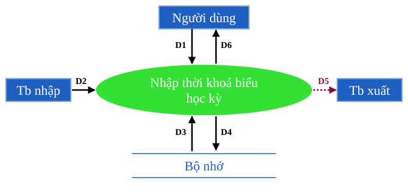

**2) Mô tả các luồng dữ liệu:**

- **D1:** Học kỳ.
- **D2:** Tệp Excel thời khoá biểu theo mẫu của trường. Mỗi dòng gồm: Mã môn, Mã lớp, Tố TC, Thực hành, HTGD, Mã
  giảng viên, Thứ, Tiết, Phòng học, Khoá học, Hệ đào tạo, Sĩ số, NBD, NKT, Cách tuần, Ghi chú, Ngôn ngữ.
- **D3:** Giai đoạn của Học kỳ (`term`). Danh mục môn học kèm Loại môn, Môn LT đi kèm, Tín chỉ mặc định
  (`course`). Danh sách mã giảng viên, mã phòng, hệ đào tạo (dữ liệu nền).
- **D4:** Xoá thời khoá biểu cũ của Học kỳ, rồi lưu thời khoá biểu mới: môn mở kèm Số tín chỉ (`offered_course`),
  lớp học phần và nhóm thực hành kèm Hình thức thực hành (`course_section`), buổi học (`meeting`).
- **D5:** *Không có*
- **D6:** Kết quả nhập: số môn mở, số lớp, số buổi học đã tạo; hoặc báo cáo lỗi theo từng dòng. Kèm danh sách cảnh
  báo trùng phòng, trùng giảng viên.

**3) Thuật toán:**

- **B1:** Nhận **D1** từ người dùng
- **B2:** Nhận **D2** từ thiết bị nhập
- **B3:** Kết nối cơ sở dữ liệu
- **B4:** Đọc **D3** từ bộ nhớ phụ
- **B5:** Kiểm tra Giai đoạn của Học kỳ (D3) là Chuẩn bị hay không (TKB-02)? Nếu không đến **B13**
- **B6:** Với mỗi dòng của D2, chuẩn hoá và kiểm tra (TKB-03, TKB-06, TKB-07), lỗi ghi vào báo cáo theo số dòng:
  - Mã môn có trong danh mục môn học (D3); Mã giảng viên và Phòng học, nếu có, có trong dữ liệu nền; Hệ đào tạo là
    một hệ có sẵn.
  - Sĩ số lấy phần số trước ngoặc, phải > 0. Khoá học quy về năm nhập học (`16` → 2021, `0` → mọi khoá).
  - Thứ và Tiết là `*` hoặc trống thì dòng không có buổi học. Ngược lại: Thứ từ thứ 2 tới chủ nhật, chuỗi Tiết quy về tiết bắt
    đầu ≤ tiết kết thúc trong 1–10 (`0` là tiết 10), NBD ≤ NKT, Cách tuần là `1` hoặc `2`.
- **B7:** Ghép dòng thành lớp (TKB-04):
  - Thực hành = 0: lớp lý thuyết hoặc lớp thường.
  - Thực hành = 1 với mã `<mã lớp LT>.n`: nhóm thực hành của lớp LT đó, thuộc môn TH đi kèm của Mã môn (D3). Lớp LT
    phải có trong tệp; các nhóm của một lớp phải cùng HTGD, và HTGD đó là Hình thức thực hành của lớp LT cha.
  - Thực hành = 1 của môn TH đứng riêng: lớp thường.
  - Mã lớp trùng nhau trong học kỳ: lỗi.
- **B8:** Gom môn mở theo Mã môn (TKB-05): Tố TC trống thì lấy Tín chỉ mặc định (D3); mọi dòng của cùng một môn
  phải cùng tín chỉ, lệch thì lỗi dòng. Tín chỉ 0 hợp lệ
- **B9:** Kiểm tra báo cáo lỗi có rỗng hay không? Nếu không rỗng đến **B12**
- **B10:** Tính cảnh báo trùng phòng và trùng giảng viên giữa các buổi học có cùng thứ, khoảng tiết giao nhau và có
  ngày học chung (QĐ11.10). Cảnh báo không chặn nhập
- **B11:** Mở transaction, lưu **D4** xuống bộ nhớ phụ, kết thúc transaction
- **B12:** Xuất **D6** cho người dùng
- **B13:** Đóng kết nối cơ sở dữ liệu
- **B14:** Kết thúc

> **Ghi chú:** Nhập theo kiểu tất cả hoặc không: chỉ cần một dòng lỗi là không lưu gì, và báo cáo liệt kê mọi dòng
> lỗi cùng lúc để Phòng Đào tạo sửa tệp một lần. Nhập lại ở giai đoạn Chuẩn bị thay toàn bộ dữ liệu cũ, an toàn vì
> chưa có dòng đăng ký nào. Bộ nhập không tạo môn, giảng viên, phòng hay hệ mới (TKB-03). Cột Khoa QL và Đã ĐK bị bỏ
> qua.

---

### 17. Lập sơ đồ luồng dữ liệu cho yêu cầu Điều chỉnh lớp học phần

Người dùng: Phòng Đào tạo. Yêu cầu: YC12. Qui định: QĐ12.1–QĐ12.4, LHP-01, LHP-02, DK-09.

**1) Sơ đồ:**

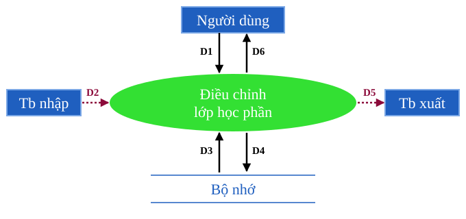

**2) Mô tả các luồng dữ liệu:**

- **D1:** Thao tác (Thêm, Sửa, Xoá) trên lớp học phần, nhóm thực hành hoặc buổi học; các thông tin mới: Sĩ số tối
  đa, Giảng viên, Phòng, Lịch học, Hình thức thực hành, Hệ đào tạo, Khoá dành cho, Ngôn ngữ, Ghi chú.
- **D2:** *Không có*
- **D3:** Giai đoạn của học kỳ (`term`). Lớp và các buổi học hiện tại, Số đã đăng ký (`course_section`, `meeting`).
  Danh sách giảng viên, phòng, hệ đào tạo (dữ liệu nền). Các buổi học khác trong học kỳ, để tính cảnh báo.
- **D4:** Lớp, nhóm thực hành hoặc buổi học sau khi thêm, sửa, xoá.
- **D5:** *Không có*
- **D6:** Cảnh báo trùng phòng, trùng giảng viên (nếu có).

**3) Thuật toán:**

- **B1:** Nhận **D1** từ người dùng
- **B2:** Kết nối cơ sở dữ liệu
- **B3:** Đọc **D3** từ bộ nhớ phụ
- **B4:** Nếu Giai đoạn (D3) là Chuẩn bị (LHP-01): kiểm tra dữ liệu mới theo đúng các qui định của mục 16 (QĐ11.6–
  QĐ11.9). Nếu không thoả đến **B9**
- **B5:** Nếu Giai đoạn (D3) từ Đăng ký trở đi (LHP-02): Thao tác phải là Sửa và chỉ đổi Sĩ số tối đa, hoặc điền
  Giảng viên, Phòng còn trống. Nếu không thoả đến **B9**
- **B6:** Nếu đổi Sĩ số tối đa: kiểm tra Sĩ số tối đa mới (D1) ≥ Số đã đăng ký (D3)? Nếu không đến **B9**
- **B7:** Lưu **D4** xuống bộ nhớ phụ. Câu lệnh sửa Sĩ số tối đa kèm điều kiện Sĩ số tối đa mới ≥ Số đã đăng ký tại
  lúc ghi
- **B8:** Tính cảnh báo trùng phòng, trùng giảng viên như B10 mục 16 và xuất **D6** cho người dùng
- **B9:** Đóng kết nối cơ sở dữ liệu
- **B10:** Kết thúc

> **Ghi chú:** Từ giai đoạn Đăng ký, không thêm, xoá lớp hay đổi lịch, vì sinh viên đã xếp thời khoá biểu theo lịch
> đó. Cách duy nhất để thêm chỗ là tăng Sĩ số tối đa (QĐ12.3). Điều kiện ở B7 chặn trường hợp sinh viên vừa đăng ký
> thêm giữa B3 và B7.

---

### 18. Lập sơ đồ luồng dữ liệu cho yêu cầu Xem danh sách sinh viên của lớp

Người dùng: Phòng Đào tạo. Yêu cầu: YC13. Biểu mẫu: BB01. Qui định: QĐ13.1, QĐ13.2, NFR-12.

**1) Sơ đồ:**

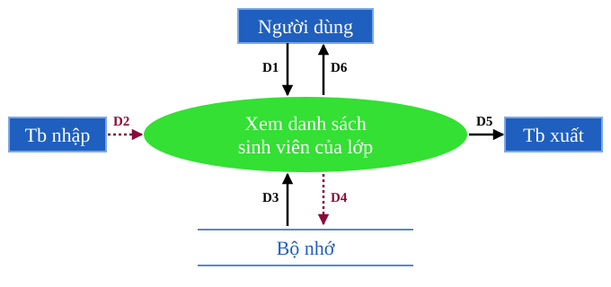

**2) Mô tả các luồng dữ liệu:**

- **D1:** Lớp học phần, Yêu cầu xuất Excel (có hoặc không).
- **D2:** *Không có*
- **D3:** Lớp: Mã lớp, Môn học, Giảng viên, Sĩ số tối đa, Số đã đăng ký (`course_section`). Các dòng đăng ký còn
  hiệu lực của lớp: Mã số sinh viên, Họ tên, Khoá, Hình thức học, Có điều kiện (`enrollment`, `student`).
- **D4:** *Không có*
- **D5:** Tệp Excel danh sách sinh viên của lớp (BB01).
- **D6:** Danh sách sinh viên của lớp kèm Số đã đăng ký / Sĩ số tối đa.

**3) Thuật toán:**

- **B1:** Nhận **D1** từ người dùng
- **B2:** Kết nối cơ sở dữ liệu
- **B3:** Đọc **D3** từ bộ nhớ phụ
- **B4:** Kiểm tra Lớp học phần (D1) có tồn tại hay không? Nếu không đến **B8**
- **B5:** Sắp xếp danh sách sinh viên (D3) theo Mã số sinh viên
- **B6:** Xuất **D6** cho người dùng
- **B7:** Nếu có Yêu cầu xuất Excel (D1) thì xuất **D5** ra tệp
- **B8:** Đóng kết nối cơ sở dữ liệu
- **B9:** Kết thúc

---

## Phần IV. Phòng Tài vụ

### 19. Lập sơ đồ luồng dữ liệu cho yêu cầu Lập phiếu thu tại quầy

Người dùng: Phòng Tài vụ. Yêu cầu: YC14. Biểu mẫu: BM6. Qui định: QĐ6, QĐ14.1–QĐ14.5, TT-01, TT-09, TT-10, HP-08,
HP-11, NFR-04.

**1) Sơ đồ:**

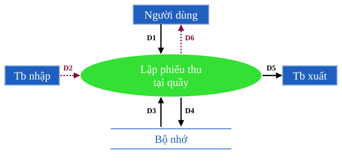

**2) Mô tả các luồng dữ liệu:**

- **D1:** Mã số sinh viên, Học kỳ, Số tiền thu, Khoá chống lặp.
- **D2:** *Không có*
- **D3:** Kết quả đã lưu của Khoá chống lặp. Hồ sơ sinh viên kèm Email (`student`). Danh sách học kỳ (`term`). Các
  dòng sổ cái của sinh viên trong Học kỳ (`ledger_entry`).
- **D4:**
  - Phiếu thu (`receipt`): Số phiếu, Ngày lập, Mã số sinh viên, Học kỳ, Số tiền thu, Kênh = Tại quầy, Thời điểm
    đóng = thời điểm lập, Người thu.
  - Dòng sổ cái ghi có Thanh toán bằng Số tiền thu.
  - Nếu phiếu thu làm sinh viên đóng đủ: sự kiện email đóng đủ (`outbox`).
  - Kết quả của Khoá chống lặp.
- **D5:** Phiếu thu học phí (BM6), in ngay sau khi lập.
- **D6:** *Không có*

**3) Thuật toán:**

- **B1:** Nhận **D1** từ người dùng
- **B2:** Kết nối cơ sở dữ liệu
- **B3:** Đọc Kết quả đã lưu của Khoá chống lặp (D3). Nếu đã có thì lấy phiếu thu đã lập và đến **B10**
- **B4:** Đọc các phần còn lại của **D3** từ bộ nhớ phụ
- **B5:** Kiểm tra Mã số sinh viên (D1) có hồ sơ và Học kỳ (D1) có trong danh sách học kỳ (D3) hay không? Nếu không
  đến **B11**
- **B6:** Kiểm tra Số tiền thu (D1) là số nguyên đồng > 0 hay không? Nếu không đến **B11**
- **B7:** Mở transaction, khoá công nợ của sinh viên trong Học kỳ. Tính Số tiền còn lại trước khi thu từ các dòng sổ
  cái (D3) như B4 mục 7
- **B8:** Lập phiếu thu và dòng ghi có. Nếu Số tiền còn lại trước khi thu > 0 và Số tiền còn lại trước khi thu − Số
  tiền thu ≤ 0 thì thêm sự kiện email đóng đủ (TT-10)
- **B9:** Lưu **D4** xuống bộ nhớ phụ, kết thúc transaction
- **B10:** Xuất **D5** ra máy in
- **B11:** Đóng kết nối cơ sở dữ liệu
- **B12:** Kết thúc

> **Ghi chú:** Thu nhiều hơn số còn lại thì phần dư thành số dư có, chuyển sang học kỳ kế tiếp ở mục 22 (HP-11).
> Phiếu thu không sửa, xoá hay huỷ được (HP-13): nhập sai số tiền thì xử lý ngoài hệ thống. Sự kiện email được lưu
> cùng transaction ghi sổ, nên email chỉ đi khi phiếu thu thật sự được ghi (mục 28).

---

### 20. Lập sơ đồ luồng dữ liệu cho yêu cầu Gán giao dịch chưa khớp

Người dùng: Phòng Tài vụ. Yêu cầu: YC15. Biểu mẫu: BM6. Qui định: QĐ15.1–QĐ15.3, TT-05, TT-07, TT-10.

**1) Sơ đồ:**

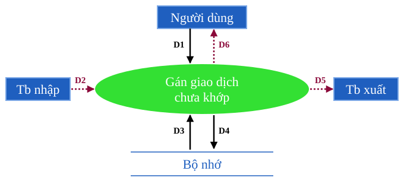

**2) Mô tả các luồng dữ liệu:**

- **D1:** Giao dịch chưa khớp, Thao tác (Gán hoặc Bỏ qua), Mã số sinh viên, Học kỳ.
- **D2:** *Không có*
- **D3:** Giao dịch: Mã giao dịch SePay, Số tiền, Nội dung, Thời điểm giao dịch, Trạng thái (`bank_transaction`).
  Hồ sơ sinh viên kèm Email. Danh sách học kỳ. Các dòng sổ cái của sinh viên trong Học kỳ.
- **D4:**
  - Thao tác Bỏ qua: Trạng thái giao dịch = Bỏ qua.
  - Thao tác Gán: Trạng thái giao dịch = Đã gán; phiếu thu với Kênh = Chuyển khoản, Số tiền = Số tiền thực nhận,
    Thời điểm đóng = Thời điểm giao dịch, Người thu = người gán; dòng ghi có Thanh toán; sự kiện email đóng đủ nếu
    đóng đủ.
- **D5:** *Không có*
- **D6:** *Không có*

**3) Thuật toán:**

- **B1:** Nhận **D1** từ người dùng
- **B2:** Kết nối cơ sở dữ liệu
- **B3:** Đọc **D3** từ bộ nhớ phụ
- **B4:** Mở transaction, khoá giao dịch. Kiểm tra Trạng thái giao dịch (D3) là Chờ gán hay không? Nếu không đến
  **B9**
- **B5:** Nếu Thao tác là Bỏ qua thì đến **B8**
- **B6:** Kiểm tra Mã số sinh viên (D1) có hồ sơ và Học kỳ (D1) có trong danh sách học kỳ (D3) hay không? Nếu không
  đến **B9**
- **B7:** Lập phiếu thu và dòng ghi có. Thêm sự kiện email đóng đủ theo cùng điều kiện như B8 mục 19
- **B8:** Lưu **D4** xuống bộ nhớ phụ, kết thúc transaction
- **B9:** Đóng kết nối cơ sở dữ liệu
- **B10:** Kết thúc

> **Ghi chú:** Thời điểm đóng là thời điểm giao dịch ngân hàng, không phải lúc gán (QĐ15.3), để xác định đúng việc
> đóng trước hay sau hạn. Khoá giao dịch ở B4 đảm bảo một giao dịch chỉ tạo một phiếu thu (TT-05), kể cả khi hai
> người cùng gán.

---

### 21. Lập sơ đồ luồng dữ liệu cho yêu cầu Lập báo cáo sinh viên chưa đóng học phí

Người dùng: Phòng Tài vụ. Yêu cầu: YC16. Biểu mẫu: BM7. Qui định: QĐ7, QĐ16.1–QĐ16.5, HP-06, HP-09, HP-10, NFR-12.

**1) Sơ đồ:**

**2) Mô tả các luồng dữ liệu:**

- **D1:** Học kỳ, Năm học, Định dạng xuất (Excel, PDF hoặc không xuất).
- **D2:** *Không có*
- **D3:** Danh sách sinh viên có dòng sổ cái trong Học kỳ (`student`). Các dòng sổ cái của từng sinh viên trong Học
  kỳ (`ledger_entry`).
- **D4:** *Không có*
- **D5:** Tệp báo cáo BM7 (Excel hoặc PDF): Học kỳ, Năm học, và bảng (Stt, Mã số sinh viên, Số tiền đăng ký, Số
  tiền phải đóng, Số tiền còn lại).
- **D6:** Báo cáo BM7.

**3) Thuật toán:**

- **B1:** Nhận **D1** từ người dùng
- **B2:** Kết nối cơ sở dữ liệu
- **B3:** Đọc **D3** từ bộ nhớ phụ
- **B4:** Với mỗi sinh viên, tính Số tiền đăng ký, Số tiền phải đóng, Số tiền còn lại từ các dòng sổ cái (D3) như
  B4 mục 7 (HP-09)
- **B5:** Giữ lại các sinh viên có Số tiền còn lại > 0 (HP-10), sắp xếp theo Mã số sinh viên, đánh Stt
- **B6:** Xuất **D6** cho người dùng
- **B7:** Nếu có Định dạng xuất (D1) thì xuất **D5** ra tệp
- **B8:** Đóng kết nối cơ sở dữ liệu
- **B9:** Kết thúc

> **Ghi chú:** Ba con số luôn tính lại từ sổ cái, không lưu sẵn, nên báo cáo phản ánh cả dòng đảo do huỷ lớp và tính
> lại học phí. Số tiền phải đóng ≤ Số tiền đăng ký vì giảm trừ luôn ≥ 0 (QĐ16.3).

---

## Phần V. Tác vụ tự động

### 22. Lập sơ đồ luồng dữ liệu cho yêu cầu Chuyển giai đoạn học kỳ và ghi nợ học phí cố định

Người dùng: Bộ định thời. Yêu cầu: YC17. Qui định: QĐ17.1–QĐ17.3, HK-03, HP-01, HP-02, HP-06, HP-11.

**1) Sơ đồ:**

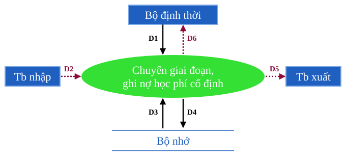

**2) Mô tả các luồng dữ liệu:**

- **D1:** Thời điểm hiện tại.
- **D2:** *Không có*
- **D3:**
  - Các học kỳ chưa ở giai đoạn Đang học: Loại, Giai đoạn, 5 mốc thời gian (`term`).
  - Danh sách sinh viên có hồ sơ: Khoá, Hệ đào tạo, đối tượng ưu tiên có Độ ưu tiên cao nhất kèm Tỉ lệ giảm.
  - Bảng phí của mọi (Khoá, Hệ đào tạo) (`fee_schedule`).
  - Số dư có ở học kỳ trước của từng sinh viên (`ledger_entry`).
- **D4:**
  - Giai đoạn mới của học kỳ.
  - Khi học kỳ chính vào giai đoạn Đăng ký: dòng ghi nợ học phí cố định và dòng giảm trừ cho mỗi sinh viên.
  - Khi học kỳ vào giai đoạn Đăng ký: cặp dòng chuyển số dư có (ghi nợ ở học kỳ cũ, ghi có ở học kỳ mới).
- **D5:** *Không có*
- **D6:** *Không có*

**3) Thuật toán:**

- **B1:** Nhận **D1** từ bộ định thời
- **B2:** Kết nối cơ sở dữ liệu
- **B3:** Đọc **D3** từ bộ nhớ phụ
- **B4:** Với mỗi học kỳ, xác định giai đoạn đúng theo Thời điểm hiện tại (D1) và các mốc (D3): Chuẩn bị → Đăng ký
  (tới Bắt đầu đăng ký) → Điều chỉnh (tới Bắt đầu điều chỉnh) → Đang học (tới Kết thúc điều chỉnh). Chỉ chuyển tiến,
  không chuyển ngược. Nếu không có học kỳ nào cần chuyển đến **B9**
- **B5:** Mở transaction cho từng học kỳ cần chuyển, cập nhật Giai đoạn với điều kiện Giai đoạn hiện tại vẫn là giai
  đoạn cũ. Nếu không cập nhật được dòng nào (lượt chạy khác đã làm) thì bỏ qua học kỳ đó
- **B6:** Nếu học kỳ vừa vào Đăng ký và là học kỳ chính: với mỗi sinh viên (D3), ghi nợ học phí cố định theo bảng
  phí của (Khoá, Hệ đào tạo) của sinh viên, kèm dòng Giảm trừ = làm tròn xuống (học phí cố định × Tỉ lệ giảm / 100)
- **B7:** Nếu học kỳ vừa vào Đăng ký: với mỗi sinh viên có số dư có ở học kỳ trước (D3), ghi cặp dòng chuyển số dư
- **B8:** Lưu **D4** xuống bộ nhớ phụ, kết thúc transaction
- **B9:** Đóng kết nối cơ sở dữ liệu
- **B10:** Kết thúc

> **Ghi chú:**
>
> - Bộ định thời chạy mỗi phút. Điều kiện ở B5 khiến hai lượt chạy chồng nhau không ghi nợ hai lần.
> - Học kỳ hè không có học phí cố định (HP-02); sinh viên chỉ trả phụ thu theo tín chỉ.
> - Thiếu bảng phí cho một (Khoá, Hệ) thì cả transaction thất bại và học kỳ ở lại giai đoạn cũ. Lỗi được ghi log để
>   Phòng Tài vụ bổ sung bảng phí.
> - Giai đoạn Kết thúc có trong vòng đời nhưng việc chuyển sang nằm ngoài phạm vi (HK-03).
> - Chốt phiếu khi vào Đang học là mục 23.

---

### 23. Lập sơ đồ luồng dữ liệu cho yêu cầu Chốt phiếu đăng ký

Người dùng: Bộ định thời. Yêu cầu: YC18. Biểu mẫu: BM5. Qui định: QĐ18.1, QĐ18.2, DK-08, DK-15.

**1) Sơ đồ:**

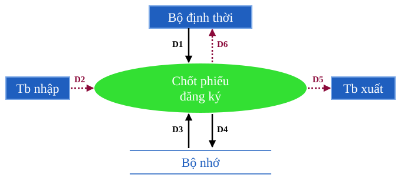

**2) Mô tả các luồng dữ liệu:**

- **D1:** Học kỳ vừa chuyển sang giai đoạn Đang học.
- **D2:** *Không có*
- **D3:** Loại học kỳ, Tín chỉ tối thiểu (`term`). Các phiếu đăng ký của học kỳ và các dòng Đã đăng ký kèm Số tín
  chỉ (`registration_form`, `enrollment`).
- **D4:** Các dòng Đã đăng ký chuyển sang Đã chốt. Danh sách cảnh báo phiếu dưới tín chỉ tối thiểu gửi Phòng Đào
  tạo.
- **D5:** *Không có*
- **D6:** *Không có*

**3) Thuật toán:**

- **B1:** Nhận **D1** từ bộ định thời
- **B2:** Kết nối cơ sở dữ liệu
- **B3:** Đọc **D3** từ bộ nhớ phụ
- **B4:** Chuyển mọi dòng Đã đăng ký của học kỳ (D3) sang Đã chốt
- **B5:** Nếu học kỳ là học kỳ chính: với mỗi phiếu, tính tổng tín chỉ các dòng đã chốt. Phiếu có tổng < Tín chỉ
  tối thiểu (D3) được đưa vào danh sách cảnh báo
- **B6:** Lưu **D4** xuống bộ nhớ phụ
- **B7:** Đóng kết nối cơ sở dữ liệu
- **B8:** Kết thúc

> **Ghi chú:** Cảnh báo không chặn và không thông báo cho sinh viên (DK-08). Bước B4 lặp lại vô hại: dòng đã chốt
> không bị đổi lần nữa. Sau khi chốt không có rút môn (DK-15).

---

### 24. Lập sơ đồ luồng dữ liệu cho yêu cầu Nhận giao dịch chuyển khoản

Người dùng: SePay. Yêu cầu: YC19. Qui định: QĐ19.1–QĐ19.3, TT-04, TT-05, ADR-0011.

**1) Sơ đồ:**

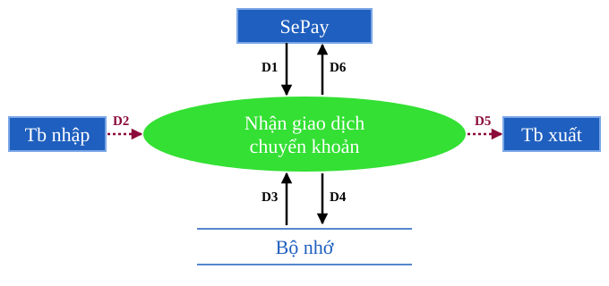

**2) Mô tả các luồng dữ liệu:**

- **D1:** Header `Authorization: Apikey …`. Nội dung webhook: Mã giao dịch SePay, Loại giao dịch (`transferType`),
  Số tài khoản nhận, Số tiền, Nội dung chuyển khoản, Thời điểm giao dịch.
- **D2:** *Không có*
- **D3:** Khoá API của SePay (cấu hình triển khai). Tài khoản nhận học phí (`system_parameter`).
- **D4:** Giao dịch mới (`bank_transaction`) với Trạng thái = Chờ xử lý. Job ghi nhận vào hàng đợi `payment`.
- **D5:** *Không có*
- **D6:** Phản hồi HTTP cho SePay: 200 khi đã lưu hoặc đã có từ trước, 401 khi sai khoá API.

**3) Thuật toán:**

- **B1:** Nhận **D1** từ SePay
- **B2:** Kết nối cơ sở dữ liệu
- **B3:** Đọc **D3** từ bộ nhớ phụ
- **B4:** Kiểm tra khoá API trong header (D1) có khớp khoá API (D3) hay không? Nếu không thì D6 = 401 và đến **B8**
- **B5:** Kiểm tra Loại giao dịch (D1) = `in` và Số tài khoản nhận (D1) = Tài khoản nhận học phí (D3) hay không? Nếu
  không thì D6 = 200 (bỏ qua, không lưu) và đến **B8**
- **B6:** Lưu giao dịch với ràng buộc duy nhất trên Mã giao dịch SePay. Nếu đã có thì không lưu lại
- **B7:** Nếu B6 vừa lưu giao dịch mới thì đưa job ghi nhận (mục 25) vào hàng đợi. D6 = 200
- **B8:** Xuất **D6** cho SePay
- **B9:** Đóng kết nối cơ sở dữ liệu
- **B10:** Kết thúc

> **Ghi chú:** Webhook trả kết quả ngay, không ghi sổ (QĐ19.3), để SePay không gửi lại vì quá thời gian chờ. Ràng
> buộc duy nhất ở B6 là lớp chống trùng thứ nhất; lớp thứ hai ở mục 25.

---

### 25. Lập sơ đồ luồng dữ liệu cho yêu cầu Ghi nhận thanh toán chuyển khoản

Người dùng: Hàng đợi. Yêu cầu: YC20. Biểu mẫu: BM6. Qui định: QĐ20.1–QĐ20.4, TT-02, TT-05, TT-06, TT-07, TT-10.

**1) Sơ đồ:**

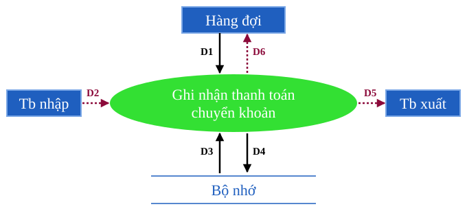

**2) Mô tả các luồng dữ liệu:**

- **D1:** Job ghi nhận: Mã giao dịch đã lưu.
- **D2:** *Không có*
- **D3:** Giao dịch: Số tiền, Nội dung, Thời điểm giao dịch, Trạng thái (`bank_transaction`). Danh sách mã số sinh
  viên và mã học kỳ. Các dòng sổ cái của sinh viên trong học kỳ khớp được.
- **D4:**
  - Khớp: Trạng thái giao dịch = Đã ghi nhận; phiếu thu với Kênh = Chuyển khoản, Số tiền = Số tiền thực nhận, Thời
    điểm đóng = Thời điểm giao dịch; dòng ghi có Thanh toán; sự kiện email đóng đủ nếu đóng đủ.
  - Không khớp: Trạng thái giao dịch = Chờ gán.
- **D5:** *Không có*
- **D6:** *Không có*

**3) Thuật toán:**

- **B1:** Nhận **D1** từ hàng đợi
- **B2:** Kết nối cơ sở dữ liệu
- **B3:** Đọc **D3** từ bộ nhớ phụ
- **B4:** Mở transaction, khoá giao dịch. Kiểm tra Trạng thái giao dịch (D3) là Chờ xử lý hay không? Nếu không (đã
  xử lý ở lượt trước) đến **B8**
- **B5:** Tìm Mã thanh toán dạng `HP` + Mã số sinh viên + Mã học kỳ trong Nội dung (D3) (TT-02). Kiểm tra Mã số sinh
  viên và Mã học kỳ có tồn tại (D3) hay không? Nếu không thì Trạng thái = Chờ gán (TT-07) và đến **B7**
- **B6:** Lập phiếu thu và dòng ghi có đúng Số tiền thực nhận (TT-06). Thêm sự kiện email đóng đủ theo cùng điều
  kiện như B8 mục 19
- **B7:** Lưu **D4** xuống bộ nhớ phụ, kết thúc transaction
- **B8:** Đóng kết nối cơ sở dữ liệu
- **B9:** Kết thúc

> **Ghi chú:** Kiểm tra trạng thái dưới khoá ở B4 là lớp chống trùng thứ hai: job chạy lại sau khi lỗi giữa chừng
> không tạo phiếu thu thứ hai (TT-05). Chuyển thiếu thì sinh viên còn nợ và mã QR kế tiếp hiện phần còn lại; chuyển
> thừa thì thành số dư có (TT-06).

---

### 26. Lập sơ đồ luồng dữ liệu cho yêu cầu Đối soát giao dịch

Người dùng: SePay (API danh sách giao dịch, gọi theo lịch hằng ngày). Yêu cầu: YC21. Qui định: QĐ21.1, QĐ21.2,
TT-08, HP-13.

**1) Sơ đồ:**

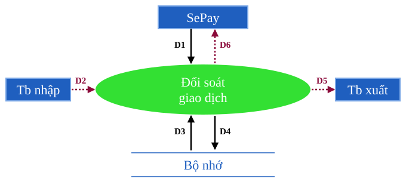

**2) Mô tả các luồng dữ liệu:**

- **D1:** Danh sách giao dịch tiền vào tài khoản nhận học phí trong khoảng đối soát, lấy từ API SePay: Mã giao dịch
  SePay, Số tiền, Nội dung, Thời điểm giao dịch.
- **D2:** *Không có*
- **D3:** Các giao dịch đã lưu trong cùng khoảng (`bank_transaction`).
- **D4:**
  - Giao dịch bị sót: lưu như B6 mục 24 và đưa job ghi nhận (mục 25) vào hàng đợi.
  - Danh sách chỗ lệch còn lại của lượt đối soát: giao dịch đã lưu nhưng không có trên SePay, giao dịch lệch số
    tiền.
- **D5:** *Không có*
- **D6:** *Không có*

**3) Thuật toán:**

- **B1:** Nhận **D1** từ SePay
- **B2:** Kết nối cơ sở dữ liệu
- **B3:** Đọc **D3** từ bộ nhớ phụ
- **B4:** So D1 với D3 theo Mã giao dịch SePay
- **B5:** Giao dịch có trong D1 nhưng không có trong D3: lưu giao dịch và đưa job ghi nhận vào hàng đợi
- **B6:** Giao dịch có trong D3 nhưng không có trong D1, hoặc có ở cả hai nhưng lệch Số tiền: đưa vào danh sách chỗ
  lệch
- **B7:** Lưu **D4** xuống bộ nhớ phụ
- **B8:** Đóng kết nối cơ sở dữ liệu
- **B9:** Kết thúc

> **Ghi chú:** Giao dịch ghi bù đi đúng đường của mục 25, nên cũng có phiếu thu và email đóng đủ. Phòng Tài vụ chỉ
> xem danh sách chỗ lệch, không có thao tác sửa; sai sót được xử lý ngoài hệ thống (HP-13).

---

### 27. Lập sơ đồ luồng dữ liệu cho yêu cầu Xử lý đăng ký có điều kiện khi có điểm

Người dùng: Bộ định thời. Yêu cầu: YC22. Biểu mẫu: BM5. Qui định: QĐ22.1–QĐ22.4, DK-05, DK-06, DK-11, HP-05.

**1) Sơ đồ:**

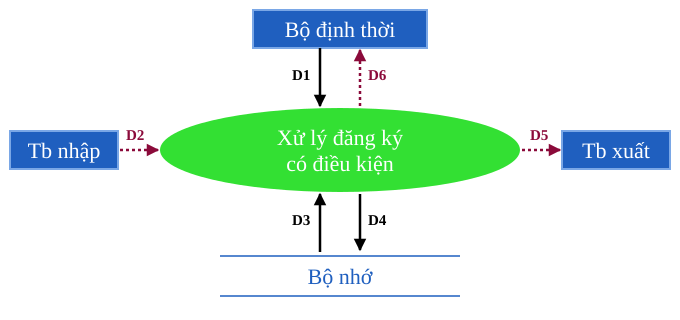

**2) Mô tả các luồng dữ liệu:**

- **D1:** Thời điểm hiện tại (lượt chạy hằng ngày).
- **D2:** *Không có*
- **D3:**
  - Các dòng đăng ký Có điều kiện còn hiệu lực: Sinh viên, Môn, Trạng thái, Giai đoạn của học kỳ (`enrollment`,
    `term`).
  - Điều kiện Tiên quyết và Học trước của môn, tính cả môn tương đương (`prerequisite`, `course_equivalence`).
  - Lần học môn điều kiện của sinh viên và điểm học phần (dữ liệu nền).
  - Dòng đi kèm và các dòng sổ cái Phụ thu, Giảm trừ của dòng, như D3 mục 5.
- **D4:**
  - Dòng thoả điều kiện: bỏ đánh dấu Có điều kiện.
  - Dòng phải huỷ: như D4 mục 5 (dòng và dòng đi kèm sang Đã huỷ, trả chỗ, đảo Phụ thu và Giảm trừ).
- **D5:** *Không có*
- **D6:** *Không có*

**3) Thuật toán:**

- **B1:** Nhận **D1** từ bộ định thời
- **B2:** Kết nối cơ sở dữ liệu
- **B3:** Đọc **D3** từ bộ nhớ phụ
- **B4:** Lấy dòng Có điều kiện kế tiếp. Nếu đã hết đến **B9**
- **B5:** Xét lại điều kiện của dòng như B12 mục 4 (QĐ22.4):
  - Điều kiện Học trước thoả khi lần học đã có điểm, Đạt hay Không đạt đều được.
  - Điều kiện Tiên quyết thoả khi điểm là Đạt.

  Nếu lần học còn chưa có điểm thì bỏ qua dòng và quay lại **B4**
- **B6:** Nếu mọi điều kiện đều thoả: bỏ đánh dấu Có điều kiện, quay lại **B4**
- **B7:** Có điều kiện Tiên quyết với điểm Không đạt. Nếu dòng đã chốt thì giữ nguyên và quay lại **B4**
- **B8:** Học kỳ của dòng còn ở giai đoạn Đăng ký hoặc Điều chỉnh: mở transaction, huỷ dòng như B7–B9 mục 5 (huỷ hai
  chiều, trả chỗ, đảo Phụ thu và Giảm trừ), kết thúc transaction, quay lại **B4**
- **B9:** Đóng kết nối cơ sở dữ liệu
- **B10:** Kết thúc

> **Ghi chú:** Điểm là dữ liệu nền nạp từ ngoài (ADR-0018), nên hệ thống không có sự kiện "khoá điểm" để phản ứng;
> bộ định thời quét hằng ngày thay cho sự kiện đó. Không có thông báo nào gửi sinh viên (DK-06): sinh viên thấy dòng
> bị huỷ khi xem phiếu ở mục 6.

---

### 28. Lập sơ đồ luồng dữ liệu cho yêu cầu Gửi email đóng đủ học phí

Người dùng: Hàng đợi. Yêu cầu: YC23. Qui định: QĐ23.1–QĐ23.4, TT-10, NFR-11, ADR-0008, ADR-0010.

**1) Sơ đồ:**

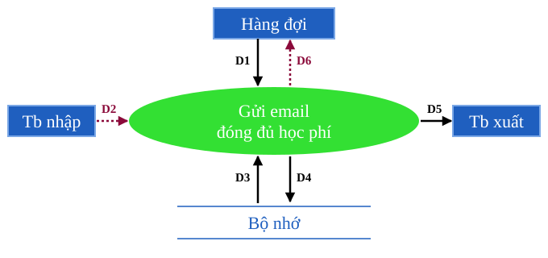

**2) Mô tả các luồng dữ liệu:**

- **D1:** Job email lấy từ sự kiện email đóng đủ trong `outbox`: Sinh viên, Học kỳ, Mã sự kiện.
- **D2:** *Không có*
- **D3:** Email và Họ tên của sinh viên (`student`). Tên học kỳ và năm học (`term`). Số tiền phải đóng và tổng số
  tiền đã đóng, tính từ sổ cái như B4 mục 7. Trạng thái sự kiện.
- **D4:** Trạng thái sự kiện = Đã gửi, kèm Thời điểm gửi.
- **D5:** Email đóng đủ gửi tới email của sinh viên: Học kỳ, Năm học, Số tiền phải đóng, Tổng số tiền đã đóng.
- **D6:** *Không có*

**3) Thuật toán:**

- **B1:** Nhận **D1** từ hàng đợi
- **B2:** Kết nối cơ sở dữ liệu
- **B3:** Đọc **D3** từ bộ nhớ phụ
- **B4:** Kiểm tra Trạng thái sự kiện (D3) đã là Đã gửi hay chưa? Nếu đã gửi đến **B7**
- **B5:** Xuất **D5** ra máy chủ email. Nếu gửi lỗi thì job được hàng đợi thử lại sau, đến **B7**
- **B6:** Lưu **D4** xuống bộ nhớ phụ
- **B7:** Đóng kết nối cơ sở dữ liệu
- **B8:** Kết thúc

> **Ghi chú:**
>
> - Điều kiện "đóng đủ" (số tiền còn lại chuyển từ > 0 về ≤ 0) đã được xét lúc ghi sổ ở mục 19, 20, 25 và 26. Mục
>   này chỉ gửi email, không tính lại điều kiện.
> - Số tiền trong email đọc lại từ sổ cái lúc gửi.
> - Sự kiện lưu cùng transaction ghi sổ (outbox, ADR-0008): email không bao giờ đi khi phiếu thu bị huỷ giữa chừng,
>   và gửi lỗi không ảnh hưởng việc ghi sổ.
> - Trình gửi có thể gửi trùng nếu lỗi xảy ra sau B5 và trước B6. Chấp nhận được, vì email chỉ mang tính thông
>   báo.
> - Đây là thông báo duy nhất của hệ thống (NFR-11).

---

## Phần VI. Thay đổi qui định

Các tham số qui định mà người dùng đổi được trên giao diện (§6 của đặc tả) được mô hình hoá trong tài liệu riêng:
[Sơ đồ luồng dữ liệu cho yêu cầu thay đổi qui định](./thay-doi-qui-dinh.md).

| # | Qui định | Người đổi |
|---|---|---|
| 1 | Đối tượng ưu tiên và tỉ lệ giảm | Phòng Đào tạo |
| 2 | Số tín chỉ của môn mở | Phòng Đào tạo |
| 3 | Đơn giá tín chỉ LT, TH mặc định | Phòng Tài vụ |
| 4 | Bảng phí theo (khoá, hệ đào tạo) | Phòng Tài vụ |
| 5 | Hạn đóng học phí | Phòng Đào tạo |
| 6 | Giới hạn tín chỉ mỗi học kỳ | Phòng Đào tạo |
| 7 | Tài khoản nhận học phí | Phòng Tài vụ |
