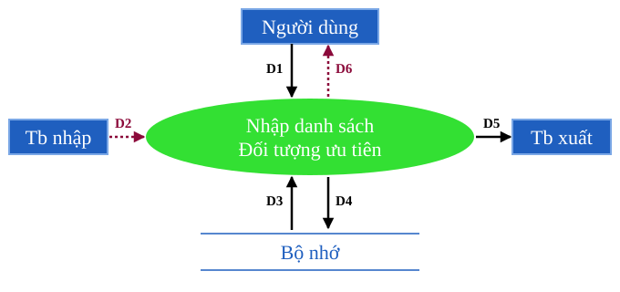
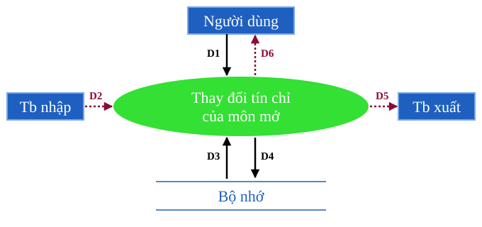
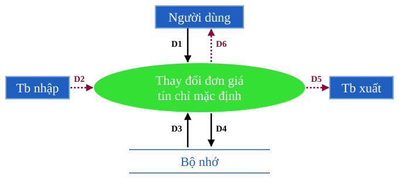
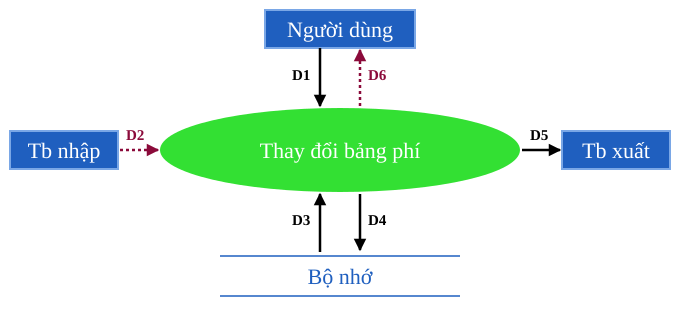
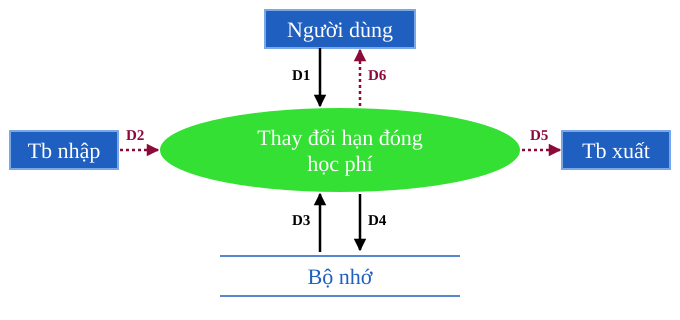
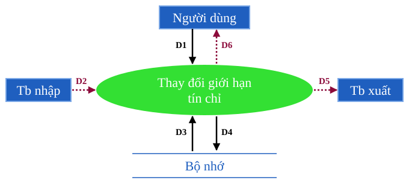
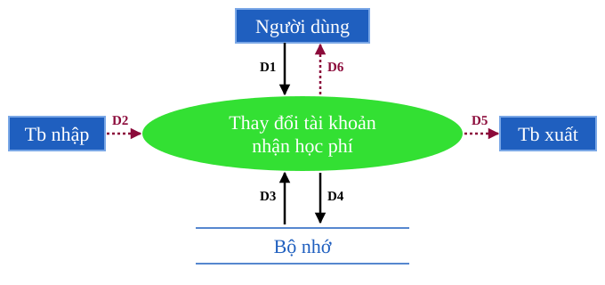

# Mô hình hoá yêu cầu thay đổi qui định

> Viết theo mẫu "Hướng dẫn mô hình hoá yêu cầu thay đổi qui định" của môn SE104: mỗi yêu cầu gồm sơ đồ luồng
> dữ liệu, mô tả các luồng D1–D6 và thuật toán B1…Bn. Nguồn qui định: [đề bài](../de-bai.md) (QĐ1, QĐ4, QĐ5,
> QĐ6), [đặc tả yêu cầu](../dac-ta-yeu-cau.md) (§6) và [requirements.md](../requirements.md) (§10).
>
> Sơ đồ sinh bằng `bun docs/mo-hinh-hoa/generate-dfd.ts`. Luồng có dữ liệu vẽ nét liền màu đen, luồng
> "Không có" vẽ nét chấm màu đỏ sẫm.

## Yêu cầu thay đổi qui định

> **Người dùng có thể thay đổi các qui định như sau** (requirements §10: thay đổi không hồi tố):
>
> - **QĐ1:** Thêm, bớt, cập nhật các đối tượng ưu tiên cùng tỉ lệ giảm học phí và độ ưu tiên.
> - **QĐ4:** Thay đổi số tín chỉ của môn mở trong một học kỳ.
> - **QĐ5:** Thay đổi đơn giá tín chỉ LT, TH mặc định; thay đổi bảng phí của từng (khoá, hệ đào tạo).
> - **QĐ6:** Thay đổi hạn đóng học phí của học kỳ.
> - **Mở rộng:** Thay đổi giới hạn tín chỉ mỗi học kỳ và tài khoản nhận học phí.

Ai được thay đổi qui định nào (đặc tả §6):

| Người dùng | Qui định |
|---|---|
| Phòng Đào tạo | Đối tượng ưu tiên, tín chỉ của môn mở, hạn đóng học phí, giới hạn tín chỉ (mục 1, 2, 5, 6) |
| Phòng Tài vụ | Đơn giá mặc định, bảng phí, tài khoản nhận học phí (mục 3, 4, 7) |

Không đổi trên giao diện: ngưỡng Đạt và các tham số kỹ thuật (thời hạn session, TTL cache, timeout…) là cấu hình
triển khai (requirements §10). Danh mục môn học, môn tương đương, tiên quyết, hệ đào tạo, giảng viên, phòng là dữ
liệu nền chỉ đọc (ADR-0019).

**Quy ước chung cho mọi mục:**

- **Bộ nhớ** là cơ sở dữ liệu PostgreSQL. Tên bảng ghi trong ngoặc, ví dụ (`priority_group`).
- **D4** luôn kèm một dòng nhật ký kiểm toán: người làm, vai trò, thời điểm, dữ liệu vào, kết quả. Lý do: mọi
  thao tác ghi đều phải được ghi nhật ký (QV-03). Bảng `audit_log` chỉ cho ghi thêm.
- **Tb xuất** là máy in, giống mẫu.
- **D6** là *Không có*, giống mẫu. Khi một bước kiểm tra không đạt, thuật toán nhảy tới bước đóng kết nối. Giao
  diện thật vẫn báo lỗi cho người dùng, nhưng mẫu không mô hình hoá luồng này.

---

## 1. Lập sơ đồ luồng dữ liệu cho yêu cầu Nhập danh sách Đối tượng ưu tiên

Người dùng: Phòng Đào tạo. Qui định: QĐ1, HS-02, HP-06.

**1) Sơ đồ:**

**2) Mô tả các luồng dữ liệu:**

- **D1:** Danh sách Đối tượng ưu tiên (Mã đối tượng, Tên đối tượng, Tỉ lệ giảm học phí (%), Độ ưu tiên).
- **D2:** *Không có*
- **D3:** Danh sách Đối tượng ưu tiên (Mã đối tượng, Độ ưu tiên) đã có (`priority_group`).
- **D4:** D1, kèm dòng nhật ký kiểm toán.
- **D5:** D1
- **D6:** *Không có*

**3) Thuật toán:**

- **B1:** Nhận **D1** từ người dùng
- **B2:** Kết nối cơ sở dữ liệu
- **B3:** Đọc **D3** từ bộ nhớ phụ
- **B4:** Kiểm tra các Mã đối tượng (D1) có thuộc danh sách Mã đối tượng (D3) hay không? Nếu có đến **B9**
- **B5:** Kiểm tra mọi Tỉ lệ giảm học phí (D1) có là số nguyên trong đoạn [0; 100] hay không? Nếu không đến **B9**
- **B6:** Kiểm tra các Độ ưu tiên (D1) có trùng nhau hoặc thuộc danh sách Độ ưu tiên (D3) hay không? Nếu có đến
  **B9**
- **B7:** Lưu **D4** xuống bộ nhớ phụ
- **B8:** Xuất **D5** ra máy in
- **B9:** Đóng kết nối cơ sở dữ liệu
- **B10:** Kết thúc

> **Ghi chú:**
>
> - B6 bảo đảm "đối tượng có độ ưu tiên cao nhất" luôn là một đối tượng duy nhất.
> - Không hồi tố: tỉ lệ giảm được chốt vào dòng giảm trừ lúc khoản nợ phát sinh (HP-06). Khoản nợ cũ chỉ đổi khi
>   hồ sơ của sinh viên được sửa trong đợt đăng ký: lúc đó học phí của học kỳ đang mở được tính lại theo tỉ lệ
>   hiện hành (HP-12, mục 10 của [sơ đồ luồng dữ liệu](./so-do-luong-du-lieu.md)).

---

## 2. Lập sơ đồ luồng dữ liệu cho yêu cầu Thay đổi tín chỉ của môn mở

Người dùng: Phòng Đào tạo. Qui định: QĐ4, DT-07, TKB-05, HP-04, ADR-0017.

**1) Sơ đồ:**

**2) Mô tả các luồng dữ liệu:**

- **D1:** Học kỳ, Môn mở, Số tín chỉ mới.
- **D2:** *Không có*
- **D3:** Giai đoạn của Học kỳ (`term`). Danh sách môn mở của Học kỳ kèm Số tín chỉ hiện tại (`offered_course`).
- **D4:** Số tín chỉ mới của Môn mở, kèm dòng nhật ký kiểm toán.
- **D5:** *Không có*
- **D6:** *Không có*

**3) Thuật toán:**

- **B1:** Nhận **D1** từ người dùng
- **B2:** Kết nối cơ sở dữ liệu
- **B3:** Đọc **D3** từ bộ nhớ phụ
- **B4:** Kiểm tra Giai đoạn của Học kỳ (D3) là Chuẩn bị hay không? Nếu không đến **B9**
- **B5:** Kiểm tra Môn mở (D1) có thuộc danh sách môn mở của Học kỳ (D3) hay không? Nếu không đến **B9**
- **B6:** Kiểm tra Số tín chỉ mới (D1) có là số nguyên ≥ 0 hay không? Nếu không đến **B9**
- **B7:** Kiểm tra Số tín chỉ mới (D1) ≠ Số tín chỉ hiện tại (D3) hay không? Nếu không đến **B9**
- **B8:** Lưu **D4** xuống bộ nhớ phụ
- **B9:** Đóng kết nối cơ sở dữ liệu
- **B10:** Kết thúc

> **Ghi chú:** Tín chỉ của môn mở thường được đặt qua cột Tố TC khi nhập thời khoá biểu (mục 16 của
> [sơ đồ luồng dữ liệu](./so-do-luong-du-lieu.md)); mục này cho sửa riêng một môn mà không phải nhập lại cả tệp.
> Tín chỉ 0 hợp lệ (ADR-0017). Chỉ sửa được ở giai đoạn Chuẩn bị, khi chưa có dòng đăng ký nào. Từ giai đoạn Đăng
> ký, số tín chỉ đã được chép vào từng dòng đăng ký (HP-04), nên không có gì để hồi tố.

---

## 3. Lập sơ đồ luồng dữ liệu cho yêu cầu Thay đổi đơn giá tín chỉ mặc định

Người dùng: Phòng Tài vụ. Qui định: QĐ5 (27.000đ/tín chỉ LT, 37.000đ/tín chỉ TH), §10.

**1) Sơ đồ:**

**2) Mô tả các luồng dữ liệu:**

- **D1:** Đơn giá tín chỉ LT mới, Đơn giá tín chỉ TH mới.
- **D2:** *Không có*
- **D3:** Đơn giá tín chỉ LT hiện tại, Đơn giá tín chỉ TH hiện tại (`system_parameter`: `tuition.theoryCreditRate`,
  `tuition.practiceCreditRate`).
- **D4:** D1, kèm dòng nhật ký kiểm toán.
- **D5:** *Không có*
- **D6:** *Không có*

**3) Thuật toán:**

- **B1:** Nhận **D1** từ người dùng
- **B2:** Kết nối cơ sở dữ liệu
- **B3:** Đọc **D3** từ bộ nhớ phụ
- **B4:** Kiểm tra Đơn giá LT (D1) và Đơn giá TH (D1) có là số nguyên đồng lớn hơn 0 hay không? Nếu không đến
  **B7**
- **B5:** Kiểm tra (Đơn giá LT, Đơn giá TH) (D1) ≠ (Đơn giá LT, Đơn giá TH) (D3) hay không? Nếu không đến **B7**
- **B6:** Lưu **D4** xuống bộ nhớ phụ
- **B7:** Đóng kết nối cơ sở dữ liệu
- **B8:** Kết thúc

> **Ghi chú:** Đơn giá mặc định chỉ là giá trị điền sẵn khi lập bảng phí cho một (khoá, hệ) mới. Bảng phí đã có
> không đổi theo. Muốn đổi đơn giá của một (khoá, hệ) đang học thì dùng mục 4.

---

## 4. Lập sơ đồ luồng dữ liệu cho yêu cầu Thay đổi bảng phí

Người dùng: Phòng Tài vụ. Qui định: QĐ5, HP-01, HP-02, HP-04.

**1) Sơ đồ:**

**2) Mô tả các luồng dữ liệu:**

- **D1:** Danh sách bảng phí, mỗi bảng gồm Khoá, Hệ đào tạo, Học phí cố định mỗi học kỳ chính, Đơn giá tín chỉ LT,
  Đơn giá tín chỉ TH.
- **D2:** *Không có*
- **D3:** Danh sách Khoá (`cohort`), danh sách Hệ đào tạo (dữ liệu nền), bảng phí hiện tại của các (Khoá, Hệ đào
  tạo) trong D1 nếu có (`fee_schedule`).
- **D4:** D1, kèm dòng nhật ký kiểm toán.
- **D5:** D1
- **D6:** *Không có*

**3) Thuật toán:**

- **B1:** Nhận **D1** từ người dùng
- **B2:** Kết nối cơ sở dữ liệu
- **B3:** Đọc **D3** từ bộ nhớ phụ
- **B4:** Kiểm tra mọi Khoá (D1) thuộc danh sách Khoá (D3) và mọi Hệ đào tạo (D1) thuộc danh sách Hệ đào tạo (D3)?
  Nếu không đến **B9**
- **B5:** Kiểm tra Học phí cố định (D1) có là số nguyên đồng lớn hơn hoặc bằng 0, và Đơn giá LT, Đơn giá TH (D1)
  có là số nguyên đồng lớn hơn 0 hay không? Nếu không đến **B9**
- **B6:** Kiểm tra các cặp (Khoá, Hệ đào tạo) trong D1 có trùng nhau hay không? Nếu có đến **B9**
- **B7:** Lưu **D4** xuống bộ nhớ phụ (tạo mới nếu (Khoá, Hệ đào tạo) chưa có bảng phí, ngược lại cập nhật)
- **B8:** Xuất **D5** ra máy in
- **B9:** Đóng kết nối cơ sở dữ liệu
- **B10:** Kết thúc

> **Ghi chú:** Thay đổi không hồi tố nhờ hai cơ chế:
>
> - Số tín chỉ và đơn giá được chốt vào dòng đăng ký lúc đăng ký (HP-04).
> - Học phí cố định được ghi nợ vào sổ cái khi học kỳ chính vào giai đoạn Đăng ký (HP-02), và sổ cái chỉ cho ghi
>   thêm (ADR-0004).
>
> Bảng phí mới áp cho lần đăng ký và lần ghi nợ sau thời điểm đổi, kể cả lần tính lại học phí khi hồ sơ sinh viên
> được sửa trong đợt (HP-12). Mỗi (khoá, hệ) có sinh viên phải có bảng phí trước khi học kỳ chính kế tiếp vào giai
> đoạn Đăng ký.

---

## 5. Lập sơ đồ luồng dữ liệu cho yêu cầu Thay đổi hạn đóng học phí

Người dùng: Phòng Đào tạo. Qui định: QĐ6, HK-02, HK-06.

**1) Sơ đồ:**

**2) Mô tả các luồng dữ liệu:**

- **D1:** Học kỳ, Hạn đóng học phí mới.
- **D2:** *Không có*
- **D3:** Danh sách Học kỳ đã có. Với Học kỳ (D1): Kết thúc điều chỉnh, Hạn đóng học phí hiện tại (`term`).
- **D4:** Hạn đóng học phí mới của Học kỳ, kèm dòng nhật ký kiểm toán.
- **D5:** *Không có*
- **D6:** *Không có*

**3) Thuật toán:**

- **B1:** Nhận **D1** từ người dùng
- **B2:** Kết nối cơ sở dữ liệu
- **B3:** Đọc **D3** từ bộ nhớ phụ
- **B4:** Kiểm tra Học kỳ (D1) có thuộc danh sách Học kỳ (D3) hay không? Nếu không đến **B10**
- **B5:** Lấy thời điểm hiện tại. Kiểm tra Hạn đóng học phí hiện tại (D3) đã qua hay chưa? Nếu đã qua đến **B10**
- **B6:** Kiểm tra Hạn đóng học phí mới (D1) ≥ thời điểm hiện tại hay không? Nếu không đến **B10**
- **B7:** Kiểm tra Kết thúc điều chỉnh (D3) < Hạn đóng học phí mới (D1) hay không? Nếu không đến **B10**
- **B8:** Kiểm tra Hạn đóng học phí mới (D1) ≠ Hạn đóng học phí hiện tại (D3) hay không? Nếu không đến **B10**
- **B9:** Lưu **D4** xuống bộ nhớ phụ
- **B10:** Đóng kết nối cơ sở dữ liệu
- **B11:** Kết thúc

> **Ghi chú:** Đây là một trường hợp của mục 14 trong [sơ đồ luồng dữ liệu](./so-do-luong-du-lieu.md) (sửa mốc
> học kỳ), tách riêng vì đề bài nêu hạn đóng là qui định của QĐ6. B5–B6 là luật mốc thời gian của HK-06: mốc đã
> qua thì khoá, giá trị mới không được ở quá khứ. B7 là thứ tự mốc của HK-02. Hạn đóng chỉ dùng để hiển thị và để
> biết thanh toán đóng trước hay sau hạn; hệ thống không có xử lý tự động nào chạy theo hạn đóng.

---

## 6. Lập sơ đồ luồng dữ liệu cho yêu cầu Thay đổi giới hạn tín chỉ

Người dùng: Phòng Đào tạo. Qui định: DK-08, §10 (mặc định 14/24 tín chỉ học kỳ chính, tối đa 12 tín chỉ học kỳ
hè).

**1) Sơ đồ:**

**2) Mô tả các luồng dữ liệu:**

- **D1:** Số tín chỉ tối thiểu học kỳ chính, Số tín chỉ tối đa học kỳ chính, Số tín chỉ tối đa học kỳ hè.
- **D2:** *Không có*
- **D3:** Các giá trị hiện tại của D1 (`system_parameter`: `registration.mainTerm.minCredits`,
  `registration.mainTerm.maxCredits`, `registration.summer.maxCredits`). Danh sách học kỳ đang ở giai đoạn Chuẩn bị
  kèm Loại học kỳ (`term`).
- **D4:** D1, giới hạn mới chép vào các học kỳ đang ở giai đoạn Chuẩn bị theo Loại học kỳ, kèm dòng nhật ký kiểm
  toán.
- **D5:** *Không có*
- **D6:** *Không có*

**3) Thuật toán:**

- **B1:** Nhận **D1** từ người dùng
- **B2:** Kết nối cơ sở dữ liệu
- **B3:** Đọc **D3** từ bộ nhớ phụ
- **B4:** Kiểm tra các giá trị (D1) có là số nguyên lớn hơn 0 hay không? Nếu không đến **B8**
- **B5:** Kiểm tra Số tín chỉ tối thiểu học kỳ chính (D1) ≤ Số tín chỉ tối đa học kỳ chính (D1) hay không? Nếu
  không đến **B8**
- **B6:** Kiểm tra D1 ≠ D3 hay không? Nếu không đến **B8**
- **B7:** Lưu **D4** xuống bộ nhớ phụ
- **B8:** Đóng kết nối cơ sở dữ liệu
- **B9:** Kết thúc

> **Ghi chú:** Không hồi tố: mỗi học kỳ giữ giới hạn tín chỉ của chính nó (`term.min_credits`,
> `term.max_credits`). Giá trị mới chỉ chép vào học kỳ chưa mở đăng ký; học kỳ đã vào giai đoạn Đăng ký giữ giới
> hạn cũ, để hai sinh viên cùng đợt không bị xét theo hai mức khác nhau.

---

## 7. Lập sơ đồ luồng dữ liệu cho yêu cầu Thay đổi tài khoản nhận học phí

Người dùng: Phòng Tài vụ. Qui định: TT-03, TT-04 (webhook bỏ qua giao dịch không vào đúng tài khoản nhận).

**1) Sơ đồ:**

**2) Mô tả các luồng dữ liệu:**

- **D1:** Ngân hàng, Số tài khoản, Tên chủ tài khoản mới.
- **D2:** *Không có*
- **D3:** Ngân hàng, Số tài khoản, Tên chủ tài khoản hiện tại (`system_parameter`: `payment.bankAccount`).
- **D4:** D1, kèm dòng nhật ký kiểm toán.
- **D5:** *Không có*
- **D6:** *Không có*

**3) Thuật toán:**

- **B1:** Nhận **D1** từ người dùng
- **B2:** Kết nối cơ sở dữ liệu
- **B3:** Đọc **D3** từ bộ nhớ phụ
- **B4:** Kiểm tra Ngân hàng, Tên chủ tài khoản (D1) có khác rỗng, và Số tài khoản (D1) có chỉ gồm chữ số hay
  không? Nếu không đến **B7**
- **B5:** Kiểm tra D1 ≠ D3 hay không? Nếu không đến **B7**
- **B6:** Lưu **D4** xuống bộ nhớ phụ
- **B7:** Đóng kết nối cơ sở dữ liệu
- **B8:** Kết thúc

> **Ghi chú:** Sau khi đổi, mã QR mới hiện tài khoản mới. Webhook bỏ qua chuyển khoản vào tài khoản cũ (TT-04), kể
> cả khi sinh viên quét QR cũ đã lưu ảnh từ trước; khoản tiền đó phải được thu ngoài hệ thống. Nên đổi ngoài thời
> gian đóng học phí. Tài khoản SePay theo dõi cũng phải đổi theo, vì đó là cấu hình bên SePay.

---

## Phụ lục: sửa và xoá đối tượng ưu tiên

Mục 1 mô hình hoá thao tác thêm, giống mẫu. Thao tác sửa và xoá dùng cùng sơ đồ, chỉ khác bước kiểm tra:

| Thao tác | Bước kiểm tra thay cho bước "mã đã có" |
|---|---|
| Sửa | Mã (D1) phải thuộc danh sách Mã (D3). Các bước kiểm tra tỉ lệ và độ ưu tiên giữ nguyên. |
| Xoá | Không còn sinh viên nào thuộc đối tượng. |

Điều kiện xoá đến từ khoá ngoại `ON DELETE RESTRICT`: Postgres sẽ từ chối xoá nếu còn sinh viên trỏ tới. Kiểm tra
trước ở ứng dụng giúp báo lỗi rõ hơn. Sửa tỉ lệ giảm không đổi các dòng giảm trừ đã ghi (ghi chú mục 1).
